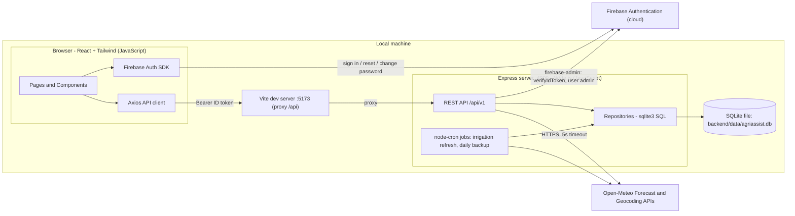
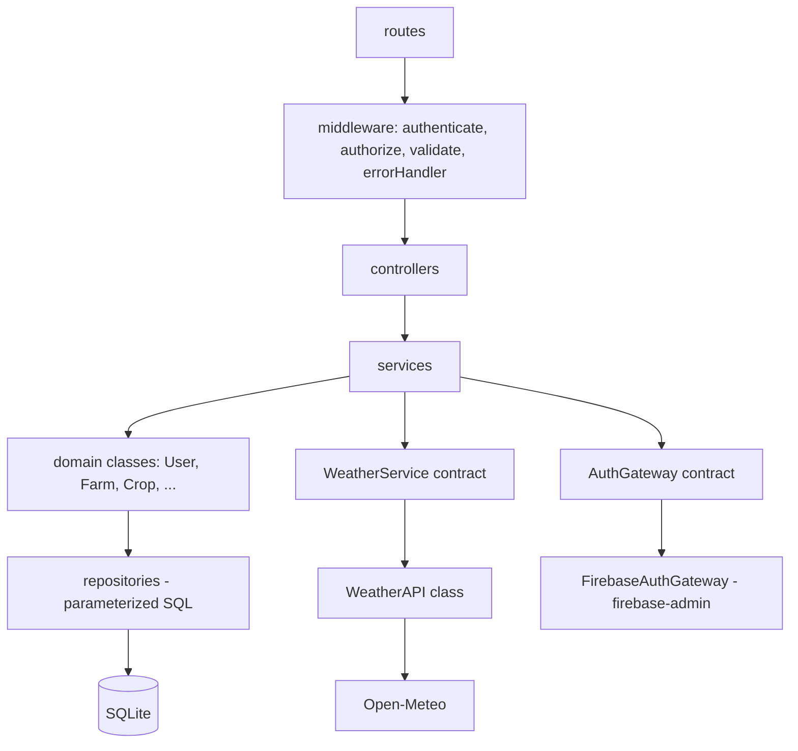
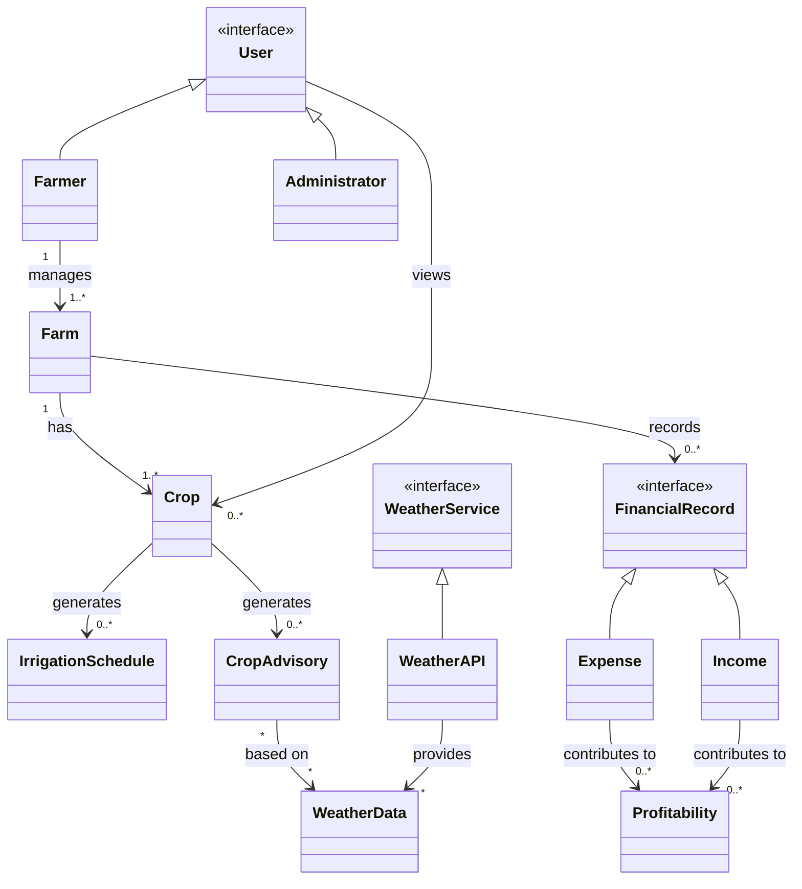
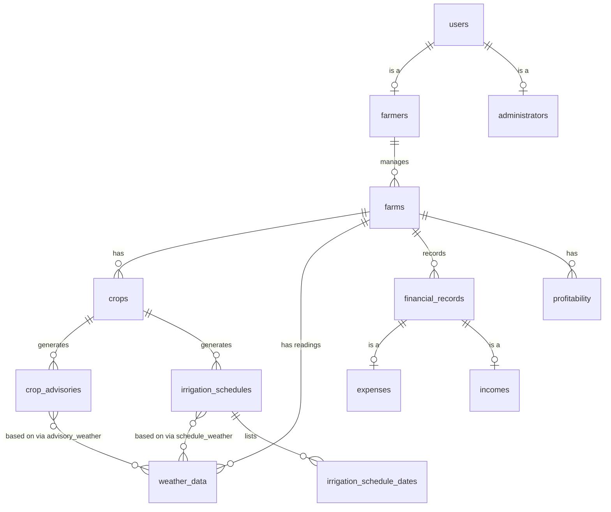
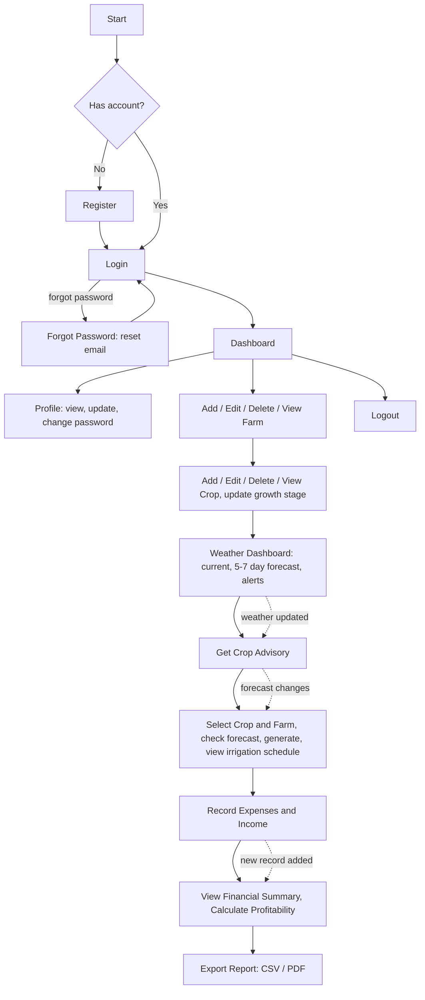
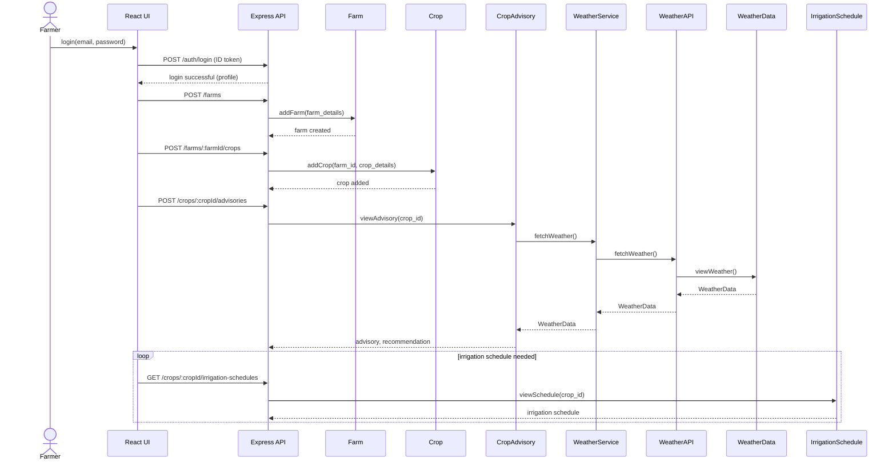
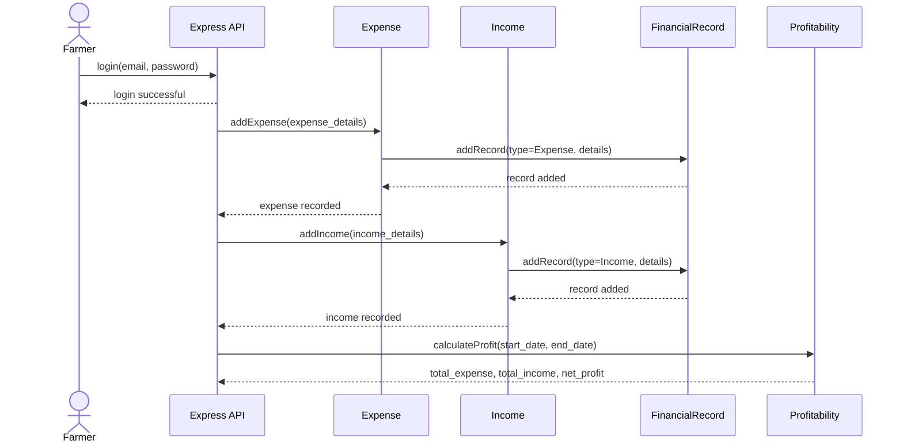

# AgriAssist — Smart Agriculture and Crop Advisory System
### Implementation Specification for an AI Coding Agent

> **Source documents:** SRS v1.0 (Smart Agriculture and Crop Advisory System), Use Case Diagrams (Set 1 and Set 2), Class Diagram, Sequence Diagrams 1 and 2, plus the owner decisions in Section 2.
> **Stack:** React + Tailwind CSS + Firebase Auth + Express + SQLite (`sqlite3` package). **JavaScript only (no TypeScript). Runs locally.**
> **Prepared for:** Antigravity IDE / any AI coding agent.

---

## 0. Rules for the AI Agent (read first)

1. **Order of authority.** Section 2 (owner decisions) and Sections 3–5 (documented deviations, reconciliations and defaults) override the SRS wherever they conflict. After that: SRS → Class Diagram → Sequence Diagrams → Use Case Diagrams.
2. **Do not invent features.** Build only what is described here. Do not add social login, payments, push/SMS/email notifications (other than Firebase's password-reset email), IoT, AI/ML models, charts, or mobile apps.
3. **Do not rename domain concepts.** Class names, attribute names and operation names come from the Class Diagram (see Section 8). Database columns and API JSON fields are **snake_case exactly as in the Class Diagram**. JavaScript method names are the camelCase form of the diagram's snake_case names (e.g. `add_farm` → `addFarm`). Entity IDs are **integers**, as in the Class Diagram.
4. **If anything is ambiguous or missing, STOP and ask the owner.** Do not guess. Items already decided are in Sections 2–5; do not re-open them.
5. **Work phase by phase (Section 15).** Do not start a phase until the previous phase's exit criteria are met and all of its tests pass. Commit once per phase with the message `phase-N: <title>`.
6. **Traceability.** Put the SRS requirement ID (e.g. `Farm.Add`, `Irrigation.Skip`, `SE-5`) in a comment above each implementing function and in the name of each test (e.g. `it('Farm.Add: creates a farm for the logged-in farmer')`).
7. **Never commit secrets or data.** The Firebase service-account key, `.env` files and SQLite database files are git-ignored. Provide `.env.example` files only. Open-Meteo needs no API key.
8. **Tests are mandatory** for every phase (Section 16). A phase with failing or missing tests is not done.
9. **The browser never touches the database.** The React app talks only to the Express API (Section 12) and to Firebase Auth. All SQL lives in `backend/src/repositories/` and is **always parameterized** (never build SQL by string concatenation).
10. **JavaScript only.** Every source file is plain JavaScript: `.js` on the backend, `.js` / `.jsx` on the frontend. Do not add TypeScript, `.ts` / `.tsx` files, `tsconfig.json`, type-checking steps or TypeScript-only tooling. Use JSDoc comments where a type description helps readers. Use ES modules (`import` / `export`, `"type": "module"`) in both packages.
11. **Async database.** The `sqlite3` driver is asynchronous: every repository function returns a Promise and every service/controller `await`s it. Use only the access layer in Section 7.4, and never use the `better-sqlite3` package.

---

## 1. Project Overview

**AgriAssist** is a web-based agricultural management platform that helps farmers plan, monitor and manage farming activities from one application. It integrates weather information with crop data to give weather-based crop advisories and irrigation schedules, and it tracks expenses, income and profitability.

**Objective (SRS 1.4):** improve agricultural efficiency, reduce unnecessary resource consumption and support data-driven decisions through an accessible, user-friendly platform.

### 1.1 Actors
| Actor | Description |
|---|---|
| **Farmer** (primary user) | Registers, manages farms and crops, views weather, gets crop advisories, generates/views irrigation schedules, records expenses and income, views profitability and exports financial reports. |
| **Administrator** | Higher privileges than a farmer. Manages farmer accounts, adds/deletes farms (per Use Case Set 1), views system statistics and all reports. |
| **Weather API** (external system) | **Open-Meteo** – provides current weather, forecasts and geocoding. |

### 1.2 Features (modules)
| # | Feature (SRS section) | Use Case Diagram items |
|---|---|---|
| 1 | User Authentication and Profile Management (4.1) | Register, Login, Logout, Update Profile, Change Password, Forgot Password (Reset) *(extend)*, Manage Farmer Accounts *(extend, Administrator)* |
| 2 | Farm Management (4.2) | Add Farm, Edit Farm, Delete Farm, View Farm Details |
| 3 | Crop Management (4.3) | Add Crop, Edit Crop, Delete Crop, View Crop Details |
| 4 | Weather Dashboard and Crop Advisory (4.4) | View Current Weather, View 5-7 Day Forecast, Get Crop Advisory, Weather Alert Notification *(extend)* |
| 5 | Irrigation Scheduling (4.5) | Select Crop & Field, Check Weather Forecast, Generate Irrigation Schedule, View Irrigation Schedule |
| 6 | Expense and Profitability Tracking (4.6) | Record Expenses, Record Income, View Financial Summary, Calculate Profitability, Export Report *(extend)* |

---

## 2. Owner Decisions (FINAL — do not change)

| Topic | Decision |
|---|---|
| Frontend | React + Tailwind CSS, **JavaScript (JSX)** (SRS CO-1) |
| Authentication | **Firebase Authentication** (email + password) |
| Backend | **Express.js** on Node.js (**JavaScript**, ES modules), a standalone server |
| Database | **SQLite**, accessed with the **`sqlite3` npm package (asynchronous) and hand-written SQL** (no ORM, no `better-sqlite3`) |
| Language | **JavaScript only** — no TypeScript anywhere (frontend or backend) |
| Weather provider | **Open-Meteo** (forecast + geocoding APIs, no API key) |
| Scope | **All** features in the SRS, class diagram, sequence diagrams **and** all extra use-case-diagram features (Forgot Password, Change Password, Weather Alert Notification, Export Report, Manage Farmer Accounts) |
| Runtime | **Local machine only** (college demo / development). No cloud deployment. |

This stack **supersedes** any earlier Firebase Cloud Functions / Firestore plan.

---

## 3. Deviations from the SRS (caused by the decisions above)

| SRS item | SRS says | Implementation |
|---|---|---|
| OE-4, CO-3, SI-1, OR-1, OR-2 | MySQL relational DB | **SQLite** (relational, with foreign keys and `ON DELETE CASCADE`). All SRS data requirements are met unchanged. |
| SI-1.2 | SQL queries through the backend | Satisfied: hand-written parameterized SQL via the `sqlite3` package. |
| CO-4, SI-3, SE-2 | JWT + hashed passwords implemented by us | **Firebase Authentication.** Passwords are hashed and stored by Firebase; Firebase ID tokens are signed JWTs that the Express server verifies with the Firebase Admin SDK. **No password is stored in SQLite.** |
| OR-4, OR-5 | Regular backups / restore | SQLite backup via `VACUUM INTO` (the `sqlite3` package has no online-backup API; see Section 7.4): a daily backup job plus `db:backup` / `db:restore` scripts (D20). |
| 1.5, SI-2 | "WeatherAPI or OpenWeatherMap" | Open-Meteo. The class name `WeatherAPI` is retained. Its `api_key` attribute is kept but is optional and unused. |
| 5.4 Availability | Available at all times except scheduled maintenance | **Not achievable** on a local-only deployment: the system is available only while the owner runs the backend. Accepted by the owner's "local only" decision. |
| 2.1 Client–server | Web interface, backend, relational DB, external Weather API | Same architecture: browser ⇄ Express ⇄ SQLite, plus Open-Meteo. |

**Platform notes**
- A **Firebase project** is required (the free Spark plan is enough for email/password sign-in). Enable the *Email/Password* provider in the Firebase console.
- The Express server needs a **service-account key** (Firebase Admin SDK) to create, disable, delete and revoke users. Store it outside git (path in `GOOGLE_APPLICATION_CREDENTIALS`).
- Internet access is required for Firebase Auth and Open-Meteo (SRS OE-5).
- `sqlite3` is a native module: use a Node.js LTS version that has prebuilt binaries for it, or have a C++ build toolchain (and Python) installed.

---

## 4. Reconciliations (minimal additions needed to satisfy the documents)

The Class Diagram alone cannot satisfy some SRS requirements or implement some associations in a relational database. These additions are the **smallest changes necessary** and are the only schema elements beyond the Class Diagram.

| # | Where | Addition | Why it is required |
|---|---|---|---|
| R1 | `Farm` | `latitude: REAL`, `longitude: REAL` (kept alongside `location: string`) | SRS 4.4.2 requires weather for the *farm location*; Open-Meteo needs coordinates. Resolved by Open-Meteo geocoding of `location` at add/edit time (or supplied explicitly). |
| R2 | `Crop` | `growth_stage: string` | SRS `Crop.Stage.Update`. |
| R3 | `WeatherData` | `farm_id` (FK), `type`, `temperature_max`, `temperature_min`, `rainfall_probability`, `wind_speed`, `weather_code`, `condition`, `fetched_at` | SRS `Weather.Display` requires temperature, humidity, rainfall probability, wind speed and conditions; the forecast needs one row per day; rows belong to a farm location. |
| R4 | `WeatherService.fetch_forecast` | Returns `WeatherData[]` (one per day) instead of a single `WeatherData` | A 5–7-day forecast is multiple days. |
| R5 | `IrrigationSchedule` | `crop_id` (FK), `skip_recommended`, `note`; child table `irrigation_schedule_dates` (the recommended and skipped dates); junction `schedule_weather` | SRS `Irrigation.Skip`; SRS 4.5.2 ("recommended irrigation date and schedule"); SRS ER "based on" Weather Data (many-to-many). |
| R6 | `Profitability` | `farm_id` (FK), `start_date`, `end_date`, `is_overall` | SRS `Profit.Report` (per farm); Sequence Diagram 2 `calculate_profit(start_date, end_date)`. |
| R7 | `CropAdvisory` | `crop_id` (FK); junction `advisory_weather` | Class Diagram "Crop generates CropAdvisory" and the many-to-many "based on" association with `WeatherData`. |
| R8 | All entities | Foreign keys (`farmer_id`, `farm_id`, `crop_id`, `user_id`) and `created_at` / `updated_at` | Relationships and ownership checks (SE-5, BR-1, BR-3). |
| R9 | `User` | `firebase_uid` (unique), `user_type` (`'farmer'` \| `'administrator'`), `status` (`'active'` \| `'disabled'`); the `password` attribute is **not stored** | Links the row to Firebase Auth; discriminates subclasses; Manage Farmer Accounts needs enable/disable; credentials live in Firebase. `Administrator.role` stays exactly as in the diagram. |
| R10 | `FinancialRecord` | Class-table inheritance: table `financial_records` (the interface's attributes) plus child tables `expenses (expense_id)` and `incomes (income_id)`, each with a unique `record_id` FK | Mirrors `Expense` / `Income` extending `FinancialRecord`. Sequence Diagram 2 shows both `add_expense` and `add_record(type=Expense)` — implement `addExpense` as delegating to `FinancialRecord.addRecord(type='Expense')` exactly once, inside one DB transaction that also inserts the `expenses` row. |

---

## 5. Defaults Chosen Where the Documents Are Silent

These are **implementation defaults**, collected here so the owner can review them. Keep every value in the config file named, so a change is a one-line edit.

| # | Topic | Default |
|---|---|---|
| D1 | Field validation | Email valid format; password ≥ 8 chars; name 2–100 chars; phone optional, 7–15 digits (optional leading `+`); address optional ≤ 255 chars. Farm: `farm_name`, `location`, `area` mandatory, `area` > 0. Crop: `crop_name`, `sowing_date` mandatory; `variety` optional; `harvest_date` optional but must be ≥ `sowing_date`. Financial record: `amount` > 0, `date` mandatory, `description` optional ≤ 255 chars. |
| D2 | Email change | Not allowed through Update Profile (name, phone, address only). Emails are stored lower-cased and are unique case-insensitively. |
| D3 | Growth stages | `Sowing, Germination, Vegetative, Flowering, Fruiting, Maturity, Harvested` (`config/constants.js`). Validated in the application (no DB CHECK, so changing the list needs no migration). |
| D4 | Units | Temperature °C, rainfall mm, wind km/h, humidity %. Farm `area` unit label = `hectares` (`VITE_AREA_UNIT`). Currency code `INR` (`VITE_CURRENCY_CODE`). Dates `YYYY-MM-DD` (TEXT). Timestamps ISO-8601 UTC (TEXT). Money stored as `REAL` rounded to 2 decimals. |
| D5 | Cascade deletes | Enforced by foreign keys (`ON DELETE CASCADE`). Deleting a farm deletes its crops, advisories, irrigation schedules, financial records, profitability rows and weather rows. Deleting a crop deletes its advisories and irrigation schedules. Deleting a farmer account deletes all of the farmer's data and the Firebase Auth user. |
| D6 | Administrator permissions | Per Use Case Set 1: Login, Logout, **Add Farm** (on behalf of a farmer), **Delete Farm**, **Manage Farmer Accounts**. Admin can *read* farms, crops and reports (needed to perform the above and for `view_all_reports`, and Class Diagram "User views Crop"). Admin **cannot** edit farms or crops, record finances, or generate advisories/schedules. |
| D7 | Manage Farmer Accounts | List, view, update profile (name, phone, address), enable/disable, delete — **farmer accounts only** (an admin cannot modify or delete admin accounts, including themselves). |
| D8 | `Administrator.manage_system` | Admin dashboard of system statistics (counts of farmers, farms, crops, financial records). |
| D9 | `Administrator.view_all_reports` | Read-only profitability report across all farms/farmers. |
| D10 | `Farmer.view_dashboard` | Dashboard with farm count, crop count, latest advisory, next irrigation date, overall net profit. |
| D11 | `Farmer.view_reports` | Profitability reports across the farmer's own farms. |
| D12 | Weather alerts | Computed on demand from the forecast (not stored), shown as an in-app banner/notification list. No email/SMS/push. Thresholds in Section 13.5. |
| D13 | Export Report | Frontend generates **CSV** and **PDF** from the JSON report endpoint (PDF via `jspdf` + `jspdf-autotable`). |
| D14 | Advisory rules | Rule-based engine; thresholds in `backend/src/config/advisoryRules.js` (Section 13.2). No machine learning. |
| D15 | Irrigation rules | Rule-based; algorithm in Section 13.3. Crop water requirements live in `backend/src/config/cropRequirements.json`, which contains **only a `default` entry**. The agent must **not** invent per-crop agronomy values; the owner/domain expert supplies them later. |
| D16 | Weather caching | Fetched weather is stored in `weather_data` (append-only). A cached fetch younger than 30 minutes (`WEATHER_CACHE_TTL_MINUTES`) is reused. If Open-Meteo fails and an older cached fetch exists, serve it with `stale: true`; otherwise return `502 WEATHER_UNAVAILABLE`. Outbound request timeout 5000 ms (SRS PE-3). The server always fetches 7 forecast days and slices to the requested `days`. No retention/cleanup of old weather rows. |
| D17 | Forecast length | 7 days; the UI lets the user choose 5, 6 or 7 (`days` query param). |
| D18 | Scheduled refresh | An in-process `node-cron` job refreshes irrigation schedules every 6 hours (`IRRIGATION_REFRESH_CRON`). It only runs while the backend process is running. Schedules can also be refreshed on demand. |
| D19 | Pagination | Admin lists use keyset pagination on the integer ID (`limit` default 20, max 100; `cursor` = last ID returned). Farmer lists are not paginated. |
| D20 | Backups | A `node-cron` job (`BACKUP_CRON`, default 02:00 daily) writes a SQLite backup (`VACUUM INTO`, Section 7.4) to `backend/data/backups/` and keeps the newest 7 (`BACKUP_RETAIN_COUNT`). `npm run db:backup` and `npm run db:restore -- <file>` do the same manually (restore requires the server to be stopped). |
| D21 | Farm minimum | The Class Diagram multiplicity "Farmer 1 — manages — 1..\* Farm" is not enforced as a minimum: a newly registered farmer has zero farms until they add one. |

---

## 6. Tech Stack

| Layer | Technology |
|---|---|
| Frontend framework | React 18 (JavaScript / JSX), built with Vite |
| Styling | Tailwind CSS (core utilities, responsive, light theme) |
| Routing / forms / HTTP | React Router v6, React Hook Form + Zod, Axios |
| Data fetching | TanStack Query (React Query) |
| Export | `jspdf`, `jspdf-autotable`, native CSV Blob |
| Auth (client) | Firebase JS SDK (Auth only) |
| Backend | Node.js (LTS) + Express.js, JavaScript ES modules (`node --watch` for dev, no build step) |
| Backend auth | `firebase-admin` (`verifyIdToken`, `createUser`, `updateUser`, `deleteUser`, `revokeRefreshTokens`) |
| Database | SQLite via the **`sqlite3`** npm package (async, wrapped in a small Promise-based `Database` class, Section 7.4), hand-written SQL, plain `.sql` migration files with a small migration runner |
| Validation (server) | Zod |
| Scheduling | `node-cron` (in-process) |
| Security middleware | `helmet`, `cors` |
| Weather | Open-Meteo Forecast API and Geocoding API (free, no key; the free tier is for non-commercial use and requires attribution — verify current terms if the project is ever used commercially) |
| Unit/integration tests | Vitest, React Testing Library, Supertest, MSW |
| Auth integration tests | Firebase Auth Emulator (via `firebase-tools`) |
| E2E | Playwright (Auth Emulator + a local mock Open-Meteo server) |
| Quality | ESLint, Prettier |

Use the latest stable versions of each package at install time and pin them in `package.json`/lockfiles.

---
## 7. Architecture

### 7.1 System architecture (all components run on the owner's machine, except Firebase Auth and Open-Meteo)



### 7.2 Backend layering



Rules:
- Controllers only parse/validate input and shape output. Business logic lives in services/domain classes. Only repositories execute SQL.
- `createApp(deps)` in `app.js` receives every dependency — `db`, `authGateway`, `weatherService`, `clock` — so tests inject an in-memory SQLite database and fakes. `server.js` builds the real dependencies, runs migrations, starts the app and the cron jobs. **Cron jobs are started in `server.js` only, never in `createApp`.**
- Services depend on the `WeatherService` and `AuthGateway` **contracts** (JSDoc-documented base classes, Section 8), never directly on `WeatherAPI` / `firebase-admin`.
- Use `db.transaction(async (tx) => { ... })` (Section 7.4) for every multi-statement write.
- On open, `db/connection.js` runs `PRAGMA foreign_keys = ON`, `PRAGMA journal_mode = WAL`, `PRAGMA busy_timeout = 5000` (Section 7.4).

### 7.3 Class relationships (from the Class Diagram)



"Contributes to" is computed (Section 13.4); it is not stored as a link table.

### 7.4 SQLite access layer (`sqlite3` is asynchronous)

The `sqlite3` package exposes a callback API. `db/connection.js` wraps it in a small `Database` class that returns Promises. **Repositories and services use only this class**, never the raw `sqlite3.Database`. No other database package is allowed (in particular not `better-sqlite3`).

| Method | Behaviour |
|---|---|
| `run(sql, params?)` | Executes one statement; resolves `{ lastID, changes }`. |
| `get(sql, params?)` | Resolves the first row object, or `undefined`. |
| `all(sql, params?)` | Resolves an array of row objects. |
| `exec(sql)` | Executes multi-statement SQL (used by the migration runner only). |
| `transaction(async (tx) => { ... })` | Runs the callback inside a transaction (see rules). `tx` has the same `run` / `get` / `all` / `exec` methods. Resolves the callback's return value. |
| `backupTo(filePath)` | Writes a consistent copy of the database with `VACUUM INTO ?` (path bound as a parameter; if the driver rejects binding, validate the path against the configured backup directory instead). The target file must not already exist. |
| `close()` | Closes the connection. |

Rules:
1. **One connection per process** (and one `:memory:` connection per test app). On open run `PRAGMA foreign_keys = ON`, `PRAGMA journal_mode = WAL`, `PRAGMA busy_timeout = 5000`.
2. **Transactions are serialised.** `transaction()` waits for an internal mutex, runs `BEGIN IMMEDIATE`, calls the callback with `tx`, runs `COMMIT`, or `ROLLBACK` and re-throws if the callback throws, then releases the mutex.
3. **Everything on `db` waits for open transactions.** Any `db.run/get/all` call made while a transaction is open waits until it finishes, so one request's statements can never land inside another request's transaction. Statements made on `tx` run immediately.
4. **Inside a transaction callback use only `tx`, never `db`** (using `db` would wait for the transaction that is waiting for it, which deadlocks).
5. **Repository functions take an executor as the first argument** (`db` or `tx`), e.g. `insertFarm(exec, farm)`. Services pass `tx` when several writes must be atomic.
6. **Migrations**: the runner wraps each file in `db.transaction` and runs the file with `tx.exec`.
7. **Constraint errors**: repositories translate `SQLITE_CONSTRAINT` errors (e.g. the unique email index) into `AppError`s such as `409 EMAIL_ALREADY_EXISTS`; other database errors surface as `500 INTERNAL`.
8. **Backup / restore**: backups use `backupTo()`. Restore (server stopped) copies the chosen backup over the database file, deletes any `-wal` / `-shm` files next to it, then opens the result and runs `PRAGMA integrity_check`.


---

## 8. Class-to-Code Mapping (implement exactly)

Domain classes live in `backend/src/models/`. Because the project is plain JavaScript, the diagram's interfaces are implemented as follows: `User` and `FinancialRecord` are base classes whose constructor throws when called directly (`if (new.target === User) throw ...`), so subclasses inherit the shared attributes and methods; `WeatherService` and `AuthGateway` are *contracts* — a base class whose methods throw `Not implemented`, documented with a JSDoc `@typedef`, and extended by `WeatherAPI` / `FirebaseAuthGateway` (and by the test fakes). Attributes marked `-` in the diagram are `#private` fields exposed through `toJSON()` / `fromRow()`. Every method that touches the database or a network service is `async` and returns a Promise. Attribute names and types are exactly the diagram's (integers stay integers), except for reconciliations R1–R10.

| Class (stereotype) | Attributes (diagram) | Operations (diagram → JS) | Notes |
|---|---|---|---|
| **User** `<<interface>>` | user_id, name, email, password, phone, address | login() → `login`, logout() → `logout`, update_profile() → `updateProfile` | `password` is **not stored** (R9). `login` verifies the Firebase ID token and `status === 'active'`; `logout` revokes the user's Firebase refresh tokens. |
| **Farmer** extends User | farmer_id, farm_count | manage_farms → `manageFarms`, view_dashboard → `viewDashboard`, view_reports → `viewReports` | Table `farmers`. `farm_count` is kept in sync by SQL triggers (Section 9). `manageFarms` is a facade over Farm CRUD. |
| **Administrator** extends User | admin_id, role | manage_users → `manageUsers`, manage_system → `manageSystem`, view_all_reports → `viewAllReports` | Table `administrators`. `role` is a free string (e.g. `"system_admin"`); authorisation uses `users.user_type`, not this field. |
| **Farm** | farm_id, farm_name, location, area | add_farm → `addFarm`, update_farm → `updateFarm`, delete_farm → `deleteFarm`, view_farm → `viewFarm` | + R1, R8. Farmer 1 — manages — farms. |
| **Crop** | crop_id, crop_name, variety, sowing_date, harvest_date | add_crop → `addCrop`, update_crop → `updateCrop`, delete_crop → `deleteCrop`, view_crop → `viewCrop` | + R2, R8. Farm 1 — has — crops. |
| **CropAdvisory** | advisory_id, recommendation, message, date | view_advisory → `viewAdvisory` | + R7. `viewAdvisory(crop_id)` fetches weather via `WeatherService`, applies rules, persists and returns the advisory (Sequence Diagram 1). |
| **IrrigationSchedule** | schedule_id, start_date, end_date, frequency, water_required | view_schedule → `viewSchedule` | + R5. Generation/refresh logic in Section 13.3. |
| **WeatherService** `<<interface>>` | — | fetch_weather → `fetchWeather(lat, lon)`, fetch_forecast → `fetchForecast(lat, lon, days)` | R4. |
| **WeatherAPI** implements WeatherService | api_key, base_url | fetch_weather, fetch_forecast | `base_url` = Open-Meteo forecast URL. `api_key` optional/unused. Timeout 5000 ms. |
| **WeatherData** | weather_id, date, temperature, humidity, rainfall, forecast | view_weather → `viewWeather` | + R3. `forecast` is the human-readable condition summary string for that day. |
| **FinancialRecord** `<<interface>>` | record_id, type, amount, date, description | add_record → `addRecord`, update_record → `updateRecord`, delete_record → `deleteRecord`, view_record → `viewRecord` | `type` ∈ `'Expense' \| 'Income'`. Farm 1 — records — 0..* FinancialRecord. |
| **Expense** extends FinancialRecord | expense_id | add_expense (sequence diagram) → `addExpense`, plus inherited record operations | R10. Table `expenses`. |
| **Income** extends FinancialRecord | income_id | add_income (sequence diagram) → `addIncome`, plus inherited record operations | R10. Table `incomes`. |
| **Profitability** | profit_id, total_expense, total_income, net_profit, date | calculate_profit → `calculateProfit(farm_id, start_date, end_date)`, view_profit → `viewProfit` | + R6. `net_profit = total_income − total_expense` (BR-6). `date` = calculation date. Returns `{ total_expense, total_income, net_profit }`. |

---

## 9. Database Design (SQLite)

### 9.1 Conventions
- File: `backend/data/agriassist.db` (`DATABASE_PATH`); tests use `:memory:`.
- Primary keys are `INTEGER PRIMARY KEY AUTOINCREMENT` named exactly as in the Class Diagram (`user_id`, `farm_id`, `crop_id`, `advisory_id`, `schedule_id`, `weather_id`, `record_id`, `expense_id`, `income_id`, `profit_id`, `farmer_id`, `admin_id`).
- Dates `YYYY-MM-DD` as `TEXT`; timestamps ISO-8601 UTC as `TEXT`. Booleans are `INTEGER` 0/1 and are converted to `true/false` in API JSON.
- Migrations are plain SQL files in `backend/src/db/migrations/`, applied in filename order by `db/migrate.js`, each inside a transaction and recorded in `schema_migrations(version TEXT PRIMARY KEY, applied_at TEXT NOT NULL)`. **Each phase adds its own migration file** (listed below). Never edit an applied migration; add a new one.

### 9.2 Entity-relationship overview



### 9.3 Migration `001_users.sql` (Phase 1)
```sql
CREATE TABLE users (
  user_id      INTEGER PRIMARY KEY AUTOINCREMENT,
  firebase_uid TEXT    NOT NULL UNIQUE,
  user_type    TEXT    NOT NULL CHECK (user_type IN ('farmer','administrator')),
  name         TEXT    NOT NULL,
  email        TEXT    NOT NULL UNIQUE COLLATE NOCASE,
  phone        TEXT,
  address      TEXT,
  status       TEXT    NOT NULL DEFAULT 'active' CHECK (status IN ('active','disabled')),
  created_at   TEXT    NOT NULL,
  updated_at   TEXT    NOT NULL
);

CREATE TABLE farmers (
  farmer_id  INTEGER PRIMARY KEY AUTOINCREMENT,
  user_id    INTEGER NOT NULL UNIQUE REFERENCES users(user_id) ON DELETE CASCADE,
  farm_count INTEGER NOT NULL DEFAULT 0 CHECK (farm_count >= 0)
);

CREATE TABLE administrators (
  admin_id INTEGER PRIMARY KEY AUTOINCREMENT,
  user_id  INTEGER NOT NULL UNIQUE REFERENCES users(user_id) ON DELETE CASCADE,
  role     TEXT    NOT NULL
);

CREATE INDEX idx_users_type_status ON users (user_type, status, user_id);
```

### 9.4 Migration `002_farms.sql` (Phase 2)
```sql
CREATE TABLE farms (
  farm_id    INTEGER PRIMARY KEY AUTOINCREMENT,
  farmer_id  INTEGER NOT NULL REFERENCES farmers(farmer_id) ON DELETE CASCADE,
  farm_name  TEXT    NOT NULL,
  location   TEXT    NOT NULL,
  area       REAL    NOT NULL CHECK (area > 0),
  latitude   REAL    NOT NULL,
  longitude  REAL    NOT NULL,
  created_at TEXT    NOT NULL,
  updated_at TEXT    NOT NULL
);
CREATE INDEX idx_farms_farmer ON farms (farmer_id);

CREATE TRIGGER trg_farms_after_insert AFTER INSERT ON farms
BEGIN
  UPDATE farmers SET farm_count = farm_count + 1 WHERE farmer_id = NEW.farmer_id;
END;

CREATE TRIGGER trg_farms_after_delete AFTER DELETE ON farms
BEGIN
  UPDATE farmers SET farm_count = MAX(farm_count - 1, 0) WHERE farmer_id = OLD.farmer_id;
END;
```

### 9.5 Migration `003_crops.sql` (Phase 3)
```sql
CREATE TABLE crops (
  crop_id      INTEGER PRIMARY KEY AUTOINCREMENT,
  farm_id      INTEGER NOT NULL REFERENCES farms(farm_id) ON DELETE CASCADE,
  crop_name    TEXT    NOT NULL,
  variety      TEXT,
  sowing_date  TEXT    NOT NULL,
  harvest_date TEXT,
  growth_stage TEXT    NOT NULL DEFAULT 'Sowing',
  created_at   TEXT    NOT NULL,
  updated_at   TEXT    NOT NULL,
  CHECK (harvest_date IS NULL OR harvest_date >= sowing_date)
);
CREATE INDEX idx_crops_farm ON crops (farm_id);
```
`farm_id` is immutable after creation (BR-3): never include it in an `UPDATE`.

### 9.6 Migration `004_weather_advisory.sql` (Phase 4)
```sql
CREATE TABLE weather_data (
  weather_id           INTEGER PRIMARY KEY AUTOINCREMENT,
  farm_id              INTEGER NOT NULL REFERENCES farms(farm_id) ON DELETE CASCADE,
  type                 TEXT    NOT NULL CHECK (type IN ('current','forecast')),
  date                 TEXT    NOT NULL,
  temperature          REAL,
  temperature_max      REAL,
  temperature_min      REAL,
  humidity             REAL,
  rainfall             REAL,
  rainfall_probability REAL,
  wind_speed           REAL,
  weather_code         INTEGER,
  condition            TEXT,
  forecast             TEXT,
  fetched_at           TEXT    NOT NULL
);
CREATE INDEX idx_weather_lookup ON weather_data (farm_id, type, fetched_at);

CREATE TABLE crop_advisories (
  advisory_id    INTEGER PRIMARY KEY AUTOINCREMENT,
  crop_id        INTEGER NOT NULL REFERENCES crops(crop_id) ON DELETE CASCADE,
  recommendation TEXT    NOT NULL,
  message        TEXT    NOT NULL,
  date           TEXT    NOT NULL,
  created_at     TEXT    NOT NULL
);
CREATE INDEX idx_advisories_crop ON crop_advisories (crop_id, advisory_id DESC);

CREATE TABLE advisory_weather (
  advisory_id INTEGER NOT NULL REFERENCES crop_advisories(advisory_id) ON DELETE CASCADE,
  weather_id  INTEGER NOT NULL REFERENCES weather_data(weather_id)     ON DELETE CASCADE,
  PRIMARY KEY (advisory_id, weather_id)
);
```
`weather_data` is **append-only**: each fetch inserts new rows that share one `fetched_at` value (one `current` row and 7 `forecast` rows). Cache lookup = rows of the newest `fetched_at` for `(farm_id, type)`.

### 9.7 Migration `005_irrigation.sql` (Phase 5)
```sql
CREATE TABLE irrigation_schedules (
  schedule_id      INTEGER PRIMARY KEY AUTOINCREMENT,
  crop_id          INTEGER NOT NULL REFERENCES crops(crop_id) ON DELETE CASCADE,
  start_date       TEXT    NOT NULL,
  end_date         TEXT    NOT NULL,
  frequency        TEXT    NOT NULL,
  water_required   TEXT    NOT NULL,
  skip_recommended INTEGER NOT NULL DEFAULT 0 CHECK (skip_recommended IN (0,1)),
  note             TEXT    NOT NULL DEFAULT '',
  created_at       TEXT    NOT NULL,
  updated_at       TEXT    NOT NULL
);
CREATE INDEX idx_schedules_crop ON irrigation_schedules (crop_id, schedule_id DESC);

CREATE TABLE irrigation_schedule_dates (
  schedule_id INTEGER NOT NULL REFERENCES irrigation_schedules(schedule_id) ON DELETE CASCADE,
  date        TEXT    NOT NULL,
  is_skipped  INTEGER NOT NULL CHECK (is_skipped IN (0,1)),
  PRIMARY KEY (schedule_id, date)
);

CREATE TABLE schedule_weather (
  schedule_id INTEGER NOT NULL REFERENCES irrigation_schedules(schedule_id) ON DELETE CASCADE,
  weather_id  INTEGER NOT NULL REFERENCES weather_data(weather_id)          ON DELETE CASCADE,
  PRIMARY KEY (schedule_id, weather_id)
);
```
API shape: `irrigation_dates` = dates with `is_skipped = 0`; `skipped_dates` = dates with `is_skipped = 1` (both sorted ascending).

### 9.8 Migration `006_finance.sql` (Phase 6)
```sql
CREATE TABLE financial_records (
  record_id   INTEGER PRIMARY KEY AUTOINCREMENT,
  farm_id     INTEGER NOT NULL REFERENCES farms(farm_id) ON DELETE CASCADE,
  type        TEXT    NOT NULL CHECK (type IN ('Expense','Income')),
  amount      REAL    NOT NULL CHECK (amount > 0),
  date        TEXT    NOT NULL,
  description TEXT    NOT NULL DEFAULT '',
  created_at  TEXT    NOT NULL,
  updated_at  TEXT    NOT NULL
);
CREATE INDEX idx_fin_farm_date      ON financial_records (farm_id, date DESC);
CREATE INDEX idx_fin_farm_type_date ON financial_records (farm_id, type, date DESC);

CREATE TABLE expenses (
  expense_id INTEGER PRIMARY KEY AUTOINCREMENT,
  record_id  INTEGER NOT NULL UNIQUE REFERENCES financial_records(record_id) ON DELETE CASCADE
);

CREATE TABLE incomes (
  income_id INTEGER PRIMARY KEY AUTOINCREMENT,
  record_id INTEGER NOT NULL UNIQUE REFERENCES financial_records(record_id) ON DELETE CASCADE
);

CREATE TABLE profitability (
  profit_id     INTEGER PRIMARY KEY AUTOINCREMENT,
  farm_id       INTEGER NOT NULL REFERENCES farms(farm_id) ON DELETE CASCADE,
  start_date    TEXT,
  end_date      TEXT,
  total_expense REAL    NOT NULL,
  total_income  REAL    NOT NULL,
  net_profit    REAL    NOT NULL,
  date          TEXT    NOT NULL,
  is_overall    INTEGER NOT NULL DEFAULT 0 CHECK (is_overall IN (0,1)),
  created_at    TEXT    NOT NULL
);
CREATE INDEX idx_profit_farm ON profitability (farm_id, profit_id DESC);
CREATE UNIQUE INDEX idx_profit_overall ON profitability (farm_id) WHERE is_overall = 1;
```
The all-time snapshot (`is_overall = 1`, null dates) is **upserted** (one per farm) after every financial-record change. Range calculations insert a new row with `is_overall = 0`. A record's `type` must match its child row (`Expense` ↔ `expenses`, `Income` ↔ `incomes`): the service inserts both in one transaction and `type` is immutable.

### 9.9 Business-rule enforcement
| Rule | Enforcement |
|---|---|
| BR-1 Every farm has exactly one registered farmer | `farms.farmer_id NOT NULL` + FK. Services verify the farmer exists. |
| BR-2 Farmer can have many farms | No limit; `farm_count` maintained by triggers (D21: no minimum). |
| BR-3 Each crop belongs to a single farm | `crops.farm_id NOT NULL` + FK; immutable. |
| BR-4 Advisory uses latest weather | Advisory generation always calls the weather layer (cache ≤ 30 min, D16). |
| BR-5 Schedules use weather + crop info | Section 13.3. |
| BR-6 Profit = income − expenses | Section 13.4. |
| SE-5 Own records only | Every farmer-facing service verifies ownership through the join `crop → farm → farmer → user` against the caller; mismatch → `403` (`404` if the ID does not exist). Admin exceptions: D6. |

---

## 10. User Workflow

### 10.1 Farmer workflow (mirrors the SRS state-transition diagram, Fig. 3)



Step list:
1. Register → sign in (email + password). If the password is forgotten, request a reset email.
2. Land on the Dashboard (farm/crop counts, latest advisory, next irrigation date, net profit).
3. Add a farm (name, location, area). The system geocodes the location.
4. Add crops to a farm; update growth stage as the crop develops.
5. Open the Weather Dashboard for a farm: current weather, 5–7-day forecast, any severe-weather alert.
6. Request a Crop Advisory for a crop (uses the latest weather).
7. Generate/view an irrigation schedule for a crop (forecast shown first; rain ⇒ skip recommendation).
8. Record expenses and income for a farm; profitability is recalculated automatically.
9. View the Financial Summary, run Calculate Profitability for a date range, export the report.
10. Logout.

### 10.2 Administrator workflow
1. Login (same login page; role read from the profile).
2. Admin Dashboard: system statistics (`manageSystem`).
3. Manage Farmer Accounts: list, view, update profile, enable/disable, delete.
4. Farms: view all farms; Add Farm on behalf of a farmer; Delete Farm.
5. Reports: view all profitability reports (`viewAllReports`).
6. Logout.

### 10.3 Sequence Diagram 1 — implemented flow



### 10.4 Sequence Diagram 2 — implemented flow



In the original diagram the `alt [record expense] / [record income]` block is the branch on `type` inside `FinancialRecord.addRecord`; each request creates exactly **one** record.

---

## 11. Project Folder Structure

```
agriassist/
├── AgriAssist.md
├── README.md
├── .gitignore                     # node_modules, .env*, backend/data/*.db*, backend/data/backups, backend/secrets
├── package.json                   # root convenience scripts (dev runs backend + frontend)
├── firebase.json                  # ONLY the Auth emulator config (used by tests)
├── .github/workflows/ci.yml       # optional: lint + tests
├── docs/
│   ├── backup-restore.md
│   └── api-examples.http
│
├── backend/                       # BACKEND: Express + SQLite (JavaScript)
│   ├── package.json  vitest.config.js  .env.example
│   ├── data/                      # git-ignored: agriassist.db, backups/
│   ├── secrets/                   # git-ignored: service-account.json
│   ├── scripts/
│   │   ├── seedAdmin.js           # creates first administrator (Firebase user + users/administrators rows)
│   │   ├── backupDb.js            # npm run db:backup
│   │   └── restoreDb.js           # npm run db:restore -- <file>
│   ├── src/
│   │   ├── server.js              # env -> open DB -> migrate -> build deps -> listen -> start cron
│   │   ├── app.js                 # createApp(deps): Express app (no cron here)
│   │   ├── container.js           # builds real deps (db, FirebaseAuthGateway, WeatherAPI, systemClock)
│   │   ├── config/
│   │   │   ├── env.js             # reads and validates environment
│   │   │   ├── constants.js       # growth stages, record types, limits
│   │   │   ├── advisoryRules.js   # thresholds (D14)
│   │   │   ├── alertRules.js      # thresholds (Section 13.5)
│   │   │   ├── irrigationRules.js # rain-skip thresholds
│   │   │   └── cropRequirements.json  # { "default": {...} } only (D15)
│   │   ├── db/
│   │   │   ├── connection.js      # sqlite3 wrapper: Promise API, pragmas, serialised transactions, backupTo (Section 7.4)
│   │   │   ├── migrate.js         # migration runner
│   │   │   └── migrations/  001_users.sql 002_farms.sql 003_crops.sql 004_weather_advisory.sql 005_irrigation.sql 006_finance.sql
│   │   ├── auth/
│   │   │   ├── AuthGateway.js         # contract (base class): verifyIdToken, createUser, deleteUser, setDisabled, revokeRefreshTokens
│   │   │   └── FirebaseAuthGateway.js # firebase-admin implementation
│   │   ├── middleware/
│   │   │   ├── authenticate.js    # verifyIdToken (revocation check) -> users row by firebase_uid -> reject disabled
│   │   │   ├── authorize.js       # requireRole('farmer' | 'administrator')
│   │   │   ├── validate.js        # Zod schema middleware
│   │   │   └── errorHandler.js    # maps AppError -> JSON error format
│   │   ├── errors/AppError.js
│   │   ├── models/                # domain classes (Section 8)
│   │   │   ├── User.js  Farmer.js  Administrator.js
│   │   │   ├── Farm.js  Crop.js
│   │   │   ├── CropAdvisory.js  IrrigationSchedule.js
│   │   │   ├── WeatherData.js
│   │   │   ├── FinancialRecord.js  Expense.js  Income.js
│   │   │   └── Profitability.js
│   │   ├── weather/
│   │   │   ├── WeatherService.js  # contract (base class)

│   │   │   ├── WeatherAPI.js      # Open-Meteo implementation
│   │   │   ├── geocoding.js       # Open-Meteo geocoding
│   │   │   └── weatherCodes.js    # WMO code -> condition text
│   │   ├── repositories/          # ONLY layer that executes SQL (parameterized)
│   │   │   ├── userRepository.js  farmRepository.js  cropRepository.js
│   │   │   ├── advisoryRepository.js  irrigationRepository.js
│   │   │   ├── weatherRepository.js   financialRepository.js
│   │   │   └── profitabilityRepository.js
│   │   ├── services/
│   │   │   ├── authService.js  profileService.js
│   │   │   ├── farmService.js  cropService.js
│   │   │   ├── weatherDashboardService.js  alertService.js  advisoryService.js
│   │   │   ├── irrigationService.js
│   │   │   ├── financialService.js  profitabilityService.js  reportService.js
│   │   │   ├── dashboardService.js
│   │   │   └── adminService.js
│   │   ├── controllers/           # one per route file
│   │   ├── routes/
│   │   │   ├── index.js           # mounts all routers under /api/v1
│   │   │   ├── auth.routes.js  farms.routes.js  crops.routes.js
│   │   │   ├── weather.routes.js  advisory.routes.js  irrigation.routes.js
│   │   │   ├── finance.routes.js  dashboard.routes.js  admin.routes.js
│   │   │   └── health.routes.js
│   │   ├── validators/            # Zod schemas per module
│   │   ├── jobs/
│   │   │   ├── scheduler.js       # registers node-cron jobs (called from server.js only)
│   │   │   ├── refreshIrrigationSchedules.js
│   │   │   └── dailyBackup.js
│   │   └── utils/  (dates.js, pagination.js, round.js, clock.js)
│   └── test/
│       ├── helpers/               # createTestApp(), FakeAuthGateway, FakeWeatherService, fixedClock, seed.js
│       ├── unit/                  # domain classes, rules, weather mapping, utils
│       ├── integration/           # Supertest + in-memory SQLite
│       ├── auth-emulator/         # FirebaseAuthGateway against the Auth Emulator
│       └── fixtures/              # open-meteo-forecast.json, geocoding.json
│
└── frontend/                      # FRONTEND: React + Tailwind (JavaScript)
    ├── package.json  vite.config.js  tailwind.config.js  postcss.config.js
    ├── .env.example
    ├── index.html
    ├── playwright.config.js
    ├── e2e/                       # Playwright specs (one per phase flow) + mock-open-meteo.js (local stub server)
    └── src/
        ├── main.jsx  App.jsx
        ├── app/
        │   ├── router.jsx         # routes (Section 12.12)
        │   ├── ProtectedRoute.jsx # auth + role guard
        │   └── queryClient.js
        ├── config/  (firebase.js, env.js, constants.js)
        ├── services/apiClient.js  # Axios; attaches ID token; maps error format
        ├── context/AuthContext.jsx
        ├── components/
        │   ├── ui/                # Button, Input, Select, Modal, ConfirmDialog, Toast, Spinner, EmptyState, Card, Table, Badge
        │   └── layout/            # AppLayout, Sidebar, Topbar (UI-6: common menu/dashboard layout)
        ├── features/
        │   ├── auth/        (api.js, hooks.js, schemas.js, pages/{Login,Register,ForgotPassword,Profile,ChangePassword}.jsx)
        │   ├── dashboard/   (pages/FarmerDashboard.jsx)
        │   ├── farms/       (api.js, hooks.js, components/FarmForm.jsx, pages/{FarmList,FarmDetails,FarmEdit}.jsx)
        │   ├── crops/       (api.js, hooks.js, components/{CropForm,GrowthStageSelect}.jsx, pages/{CropDetails,CropEdit}.jsx)
        │   ├── weather/     (api.js, components/{CurrentWeatherCard,ForecastList,AlertBanner}.jsx, pages/WeatherDashboard.jsx)
        │   ├── advisory/    (api.js, components/AdvisoryCard.jsx, pages/CropAdvisory.jsx)
        │   ├── irrigation/  (api.js, components/{ScheduleCard,SkipNotice}.jsx, pages/IrrigationScheduling.jsx)
        │   ├── finance/     (api.js, components/{RecordForm,RecordTable,SummaryCards,ExportButtons}.jsx, pages/{Finance,Profitability,Reports}.jsx)
        │   └── admin/       (api.js, pages/{AdminDashboard,FarmerAccounts,FarmerAccountDetails,AdminFarms,AllReports}.jsx)
        
        ├── utils/  (format.js, dates.js, exportCsv.js, exportPdf.js)
        └── test/  (setup.js, msw handlers, test-utils.jsx)
```

---
## 12. Main APIs

Base path: `/api/v1` (backend listens on `http://localhost:4000`; the frontend calls `/api/v1` through the Vite dev proxy). All bodies/responses are JSON with **snake_case** fields (SRS CI-3). All IDs are integers. Every endpoint except `POST /auth/register` and `GET /health` requires `Authorization: Bearer <Firebase ID token>` (SE-1).

### 12.1 Conventions
| Item | Convention |
|---|---|
| Success | `200` / `201`; body `{ "data": <resource or array> }`; admin lists add `"next_cursor": number \| null` |
| Delete | `200` with `{ "data": { "deleted": true, "id": <id> } }` |
| Error body | `{ "error": { "code": "<CODE>", "message": "<human readable>", "details": [ ... ] } }` |
| Status codes | `400` validation (`VALIDATION_ERROR`) and unknown farm location (`LOCATION_NOT_FOUND`), `401` missing/invalid/revoked token (`UNAUTHENTICATED`), `403` forbidden / disabled / no profile (`FORBIDDEN`, `ACCOUNT_DISABLED`, `PROFILE_NOT_FOUND`), `404` (`NOT_FOUND`), `409` (`EMAIL_ALREADY_EXISTS`), `502` upstream weather/geocoding failure (`WEATHER_UNAVAILABLE`), `500` (`INTERNAL`) |
| Roles | **F** = farmer (own records only, SE-5), **A** = administrator, **P** = public |
| Profile object | `{ user_id, user_type, name, email, phone, address, status, created_at, updated_at, farmer_id?, farm_count?, admin_id?, role? }` (`farmer_*` only for farmers, `admin_*`/`role` only for administrators; never includes `firebase_uid`) |
| Authentication flow | `authenticate` middleware: verify the Firebase ID token (`checkRevoked = true`) → find the `users` row by `firebase_uid` → `403 PROFILE_NOT_FOUND` if absent → `403 ACCOUNT_DISABLED` if `status = 'disabled'` → attach the user. **The role always comes from `users.user_type`.** |

### 12.2 Authentication and profile (Feature 1)
| Method & path | Role | Purpose / SRS ID | Request → Response |
|---|---|---|---|
| `POST /auth/register` | P | `Auth.Register` | `{ name, email, password, phone?, address? }` → `201` profile. Order: validate → `authGateway.createUser` (Firebase) → in one SQL transaction insert `users` (`user_type='farmer'`) and `farmers` (`farm_count=0`). If the SQL insert fails, delete the Firebase user (compensation). Duplicate email → `409`. Always registers a **farmer**; administrators are created only by `scripts/seedAdmin.js`. |
| `POST /auth/login` | F, A | `Auth.Login`, sequence diagram `login` | Called **after** the client signs in with Firebase Auth (`signInWithEmailAndPassword`). The `authenticate` middleware does the verification; the handler returns `{ data: profile }`. Disabled → `403 ACCOUNT_DISABLED` (client must sign out). |
| `POST /auth/logout` | F, A | `Auth.Logout` | `authGateway.revokeRefreshTokens(uid)`; client then calls `signOut()`. |
| `GET /auth/profile` | F, A | `Auth.Profile.View` | → profile. |
| `PUT /auth/profile` | F, A | `Auth.Profile.Update` | `{ name?, phone?, address? }` → updated profile (email is not changeable, D2). |

**Client-side Firebase operations (no custom endpoint):**
- **Forgot Password (Reset):** `sendPasswordResetEmail(auth, email)`. UI always shows a neutral confirmation message.
- **Change Password:** `reauthenticateWithCredential` using the current password, then `updatePassword`.

### 12.3 Farms (Feature 2)
| Method & path | Role | SRS ID | Notes |
|---|---|---|---|
| `POST /farms` | F, A | `Farm.Add`, `Farm.Validate` | `{ farm_name, location, area, latitude?, longitude?, farmer_id? }`. **F:** `farmer_id` is the caller's own (body value ignored). **A:** `farmer_id` required and must be an existing `farmers.farmer_id`. If `latitude/longitude` are omitted, geocode `location` via Open-Meteo (`LOCATION_NOT_FOUND` → `400`; geocoder unreachable → `502`). `farm_count` is updated by the DB trigger. |
| `GET /farms` | F, A | `Farm.View` | **F:** own farms. **A:** all farms, optional `?farmer_id=`. |
| `GET /farms/:farmId` | F, A | `Farm.View` | Farm details. |
| `PUT /farms/:farmId` | F | `Farm.Edit`, `Farm.Validate` | Partial update; re-geocodes if `location` changes and no coordinates are given. **Admin → `403`** (D6). |
| `DELETE /farms/:farmId` | F, A | `Farm.Delete` | FK cascade (D5). UI must show a confirmation dialog first. |

### 12.4 Crops (Feature 3)
| Method & path | Role | SRS ID | Notes |
|---|---|---|---|
| `POST /farms/:farmId/crops` | F | `Crop.Add` | `{ crop_name, variety?, sowing_date, harvest_date?, growth_stage? }`; default `growth_stage = 'Sowing'`. |
| `GET /farms/:farmId/crops` | F, A | `Crop.View` | All crops of a farm. |
| `GET /crops/:cropId` | F, A | `Crop.View` | Crop details. |
| `PUT /crops/:cropId` | F | `Crop.Edit` | Partial update (`farm_id` immutable, BR-3). |
| `PATCH /crops/:cropId/stage` | F | `Crop.Stage.Update` | `{ growth_stage }` must be one of D3. |
| `DELETE /crops/:cropId` | F | `Crop.Delete` | FK cascade of advisories and schedules. |

### 12.5 Weather dashboard (Feature 4)
| Method & path | Role | SRS ID | Notes |
|---|---|---|---|
| `GET /farms/:farmId/weather/current` | F, A | `Weather.Fetch`, `Weather.Display` | → `WeatherData` (`type:'current'`): temperature, humidity, rainfall, rainfall_probability, wind_speed, condition. Adds `stale: true` if served from an expired cache after an upstream failure. |
| `GET /farms/:farmId/weather/forecast?days=7` | F, A | `Weather.Fetch`, `Weather.Display` | `days` ∈ {5, 6, 7} (default 7) → array of daily `WeatherData` (`type:'forecast'`). |
| `GET /farms/:farmId/weather/alerts` | F, A | Weather Alert Notification | → `[ { alert_type, severity, date, message } ]` (Section 13.5); empty array if none. |

### 12.6 Crop advisory (Feature 4)
| Method & path | Role | SRS ID | Notes |
|---|---|---|---|
| `POST /crops/:cropId/advisories` | F | `Advisory.Generate`, BR-4 | Implements Sequence Diagram 1 `view_advisory(crop_id)`: gets weather via `WeatherService`, applies Section 13.2 rules, inserts a `crop_advisories` row plus `advisory_weather` links, returns the advisory. |
| `GET /crops/:cropId/advisories` | F, A | `Advisory.Display` | History, newest first. |
| `GET /crops/:cropId/advisories/latest` | F, A | `Advisory.Display` | Latest advisory or `404`. |

### 12.7 Irrigation scheduling (Feature 5)
| Method & path | Role | SRS ID | Notes |
|---|---|---|---|
| `POST /crops/:cropId/irrigation-schedules` | F | `Irrigation.Generate`, BR-5 | Generates and stores a schedule (Section 13.3). Response includes `irrigation_dates`, `skipped_dates`, `skip_recommended`, `note`. |
| `GET /crops/:cropId/irrigation-schedules` | F, A | `Irrigation.View` | Sequence Diagram 1 `view_schedule(crop_id)`; newest first. |
| `POST /irrigation-schedules/:scheduleId/refresh` | F | `Irrigation.Update`, `Irrigation.Skip` | Recomputes from the latest forecast and updates the schedule in place. |

Use cases "Select Crop & Field" and "Check Weather Forecast" are UI steps: the page selects a farm (field) and crop, then shows `GET /farms/:farmId/weather/forecast` before the Generate button.

### 12.8 Expenses, income and profitability (Feature 6)
| Method & path | Role | SRS ID | Notes |
|---|---|---|---|
| `POST /farms/:farmId/expenses` | F | `Expense.Add` | `{ amount, date, description? }` → `FinancialRecord` (`type:'Expense'`, with `expense_id`). Then recalculates the farm's overall profitability (R10, Section 13.4). |
| `POST /farms/:farmId/incomes` | F | `Income.Add` | Same, `type:'Income'`, with `income_id`. |
| `GET /farms/:farmId/financial-records?type=&from=&to=` | F, A | `Expense.View` | Records sorted by `date` DESC; `type` optional (`Expense`/`Income`). |
| `PUT /financial-records/:recordId` | F | Class `update_record` | `{ amount?, date?, description? }` (type immutable). Recalculates overall profitability. |
| `DELETE /financial-records/:recordId` | F | Class `delete_record` | Recalculates overall profitability. |
| `GET /farms/:farmId/financial-summary?start_date=&end_date=` | F, A | View Financial Summary | Live totals (nothing stored): `{ farm_id, start_date, end_date, total_income, total_expense, net_profit, record_count }`. |
| `POST /farms/:farmId/profitability/calculate` | F | `Profit.Calculate`, sequence diagram `calculate_profit(start_date, end_date)` | `{ start_date?, end_date? }` → inserts a `profitability` row and returns `{ profit_id, total_expense, total_income, net_profit, start_date, end_date, date }`. |
| `GET /farms/:farmId/profitability` | F, A | `Profit.Report`, `view_profit` | Saved profitability rows for a farm (newest first). |
| `GET /farms/:farmId/reports/financial?start_date=&end_date=` | F, A | Export Report | JSON dataset `{ farm, period, records[], totals, generated_at }`; the browser creates the CSV/PDF (D13). |

### 12.9 Dashboard and reports
| Method & path | Role | Purpose |
|---|---|---|
| `GET /dashboard` | F | `Farmer.view_dashboard` (D10): `{ farm_count, crop_count, latest_advisory, next_irrigation_date, overall_net_profit }`. |
| `GET /reports/profitability` | F | `Farmer.view_reports` (D11): the overall profitability row of each of the farmer's farms. |

### 12.10 Administration
| Method & path | Role | Purpose |
|---|---|---|
| `GET /admin/users?status=&limit=&cursor=` | A | List farmer accounts, newest first (`user_id` DESC), keyset pagination (D19). |
| `GET /admin/users/:userId` | A | View a farmer account (`userId` = `users.user_id`). |
| `PUT /admin/users/:userId` | A | Update `{ name?, phone?, address? }` (use case: Manage Farmer Accounts *extends* Update Profile). |
| `PATCH /admin/users/:userId/status` | A | `{ status: 'active' \| 'disabled' }`. Order: `authGateway.setDisabled` (and `revokeRefreshTokens` when disabling) → update `users.status`. |
| `DELETE /admin/users/:userId` | A | Order: `authGateway.deleteUser` (treat "user not found" as success so a retry works) → `DELETE FROM users` (FK cascade removes the farmer's data, D5). |
| `GET /admin/stats` | A | `Administrator.manage_system` (D8): `{ farmer_count, farm_count, crop_count, financial_record_count }`. |
| `GET /admin/reports` | A | `Administrator.view_all_reports` (D9): overall profitability row for every farm with farm name and farmer name. |

All `/admin/users*` operations reject targets whose `user_type` is not `farmer` (`403`).

### 12.11 System
| Method & path | Role | Purpose |
|---|---|---|
| `GET /health` | P | `{ "status": "ok" }` |

### 12.12 Frontend routes
| Route | Page | Role |
|---|---|---|
| `/login`, `/register`, `/forgot-password` | Auth pages (UI-2) | public |
| `/` | Farmer Dashboard | F |
| `/profile`, `/profile/change-password` | Profile, Change Password | F, A |
| `/farms`, `/farms/:farmId`, `/farms/:farmId/edit` | Farm list, details (with crops), edit | F (A: list/details only) |
| `/crops/:cropId`, `/crops/:cropId/edit` | Crop details, edit, stage update | F (A: details only) |
| `/weather` | Weather Dashboard (farm selector, current, forecast, alerts) | F |
| `/advisory` | Crop Advisory (farm → crop → Get Advisory, history) | F |
| `/irrigation` | Irrigation Scheduling (farm + crop select, forecast, generate/view/refresh) | F |
| `/finance` | Records, add expense/income, summary (farm selector) | F |
| `/finance/profitability` | Calculate/view profitability, export | F |
| `/reports` | Farmer reports | F |
| `/admin` | Admin Dashboard (stats) | A |
| `/admin/users`, `/admin/users/:userId` | Manage Farmer Accounts | A |
| `/admin/farms` | All farms; add on behalf of farmer; delete | A |
| `/admin/reports` | All reports | A |

Common UI rules: responsive layout (UI-1, HI-1); same sidebar/topbar on every authenticated page (UI-6); inline validation messages (UD-2, UI-5); toast confirmations and errors (UI-5); confirmation dialog before any delete; helpful labels and help text (UD-3); loading and empty states.

---

## 13. Business Logic Specifications

### 13.1 Weather integration (Open-Meteo)

`WeatherAPI` (implements `WeatherService`) uses these endpoints (verify against the current Open-Meteo docs at implementation time):

```
GET {base_url}/v1/forecast
    ?latitude={lat}&longitude={lon}
    &current=temperature_2m,relative_humidity_2m,precipitation,weather_code,wind_speed_10m
    &hourly=relative_humidity_2m
    &daily=weather_code,temperature_2m_max,temperature_2m_min,precipitation_sum,precipitation_probability_max,wind_speed_10m_max
    &forecast_days={days}&timezone=auto&wind_speed_unit=kmh

GET https://geocoding-api.open-meteo.com/v1/search?name={location}&count=1&language=en&format=json
```
`base_url` default: `https://api.open-meteo.com`. In E2E tests it points to the local mock server.

**Mapping → `WeatherData`**
| Field | `fetchWeather` (type `current`) | `fetchForecast` (type `forecast`, one per day) |
|---|---|---|
| date | date part of `current.time` | `daily.time[i]` |
| temperature | `current.temperature_2m` | `round((max + min) / 2, 1)` |
| temperature_max / min | today's `daily` max / min | `daily.temperature_2m_max/min[i]` |
| humidity | `current.relative_humidity_2m` | mean of that day's 24 hourly `relative_humidity_2m` values, 1 decimal |
| rainfall (mm) | `current.precipitation` | `daily.precipitation_sum[i]` |
| rainfall_probability (%) | today's `daily.precipitation_probability_max[0]` | `daily.precipitation_probability_max[i]` |
| wind_speed (km/h) | `current.wind_speed_10m` | `daily.wind_speed_10m_max[i]` |
| weather_code / condition / forecast | from `current.weather_code` | from `daily.weather_code[i]` |

`condition` and `forecast` use the WMO code table in `weatherCodes.js`: 0 Clear sky; 1 Mainly clear; 2 Partly cloudy; 3 Overcast; 45, 48 Fog; 51–55 Drizzle; 56–57 Freezing drizzle; 61–65 Rain; 66–67 Freezing rain; 71–75 Snowfall; 77 Snow grains; 80–82 Rain showers; 85–86 Snow showers; 95 Thunderstorm; 96, 99 Thunderstorm with hail.

**Caching and failure (D16)** — `weatherRepository` / `weatherDashboardService`:
```sql
-- newest cached fetch for a farm and type
SELECT * FROM weather_data
WHERE farm_id = ? AND type = ?
  AND fetched_at = (SELECT MAX(fetched_at) FROM weather_data WHERE farm_id = ? AND type = ?)
ORDER BY date;
```
If that `fetched_at` is within the TTL, use it. Otherwise call Open-Meteo (always `forecast_days = 7`, timeout 5000 ms), then insert one `current` row and 7 `forecast` rows in one transaction with a single shared `fetched_at`. On upstream failure use the older cached fetch (`stale: true`) or return `502 WEATHER_UNAVAILABLE`. "Today" for schedules and advisories = the first date in the forecast response (already in the farm's timezone).

### 13.2 Crop advisory rules (`advisoryRules.js`, defaults per D14)

Inputs: crop (name, growth_stage, harvest_date), current `WeatherData`, forecast days 0–2 ("next 3 days") and 0–4 ("next 5 days"). Evaluate the rules in this priority order. `recommendation` = headline of the **first** triggered rule; `message` = all triggered rule messages joined by a space. If nothing triggers, use the default.

| Priority | Rule | Condition (all thresholds are config constants) | Message |
|---|---|---|---|
| 1 | Harvest before rain | `harvest_date` within 7 days **and** any of next 3 days `rainfall_probability ≥ 50` | "Rain is likely near your harvest date. Plan harvesting before the rain." |
| 2 | Heavy rain | any of next 3 days `rainfall_probability ≥ 70` **or** `rainfall ≥ 10` mm | "Heavy rain expected. Postpone irrigation, fertilizer and pesticide spraying; ensure field drainage." |
| 3 | Heat stress | any of next 3 days `temperature_max ≥ 38` °C | "High temperatures expected. Irrigate in early morning or evening and consider mulching." |
| 4 | Cold / frost | any of next 3 days `temperature_min ≤ 5` °C | "Low temperatures expected. Protect the crop from cold or frost." |
| 5 | Strong wind | any of next 3 days `wind_speed ≥ 30` km/h | "Strong winds expected. Avoid spraying and support tall crops." |
| 6 | Fungal risk | current `humidity ≥ 85` **and** `20 ≤ temperature ≤ 30` | "High humidity with mild temperatures raises fungal disease risk. Inspect the crop regularly." |
| 7 | Dry spell | sum of `rainfall` over next 5 days `< 2` mm **and** `temperature ≥ 30` | "Dry and warm weather ahead. Plan irrigation." |
| default | — | none triggered | "Weather conditions are favourable. Continue routine crop care." |

Persist `date` = forecast "today"; link the weather rows used (the `current` row and the forecast rows for the next 5 days) in `advisory_weather`.

### 13.3 Irrigation scheduling algorithm (`irrigationRules.js`, `cropRequirements.json`)

1. Load the crop and its farm; get the 7-day forecast (D[0]..D[6]) through the weather layer.
2. `req = cropRequirements[crop_name.toLowerCase()] ?? cropRequirements.default`. The `default` entry is a **placeholder** the owner must review: `{ "interval_days": 5, "water_mm": 25 }`.
3. `start_date = D[0].date`, `end_date = D[6].date`.
4. Candidate irrigation dates: `D[0], D[0 + interval_days], D[0 + 2·interval_days], …` while inside the horizon.
5. A day is **rainy** if `rainfall_probability ≥ 60` **or** `rainfall ≥ 5` mm (`RAIN_PROB_SKIP`, `RAIN_MM_SKIP`).
6. Write one `irrigation_schedule_dates` row per candidate date: `is_skipped = 1` for rainy dates, otherwise `0` (`Irrigation.Skip`).
7. `skip_recommended = 1` if any candidate date was skipped; `note` = `"Rainfall expected on <dates>; skip irrigation on these dates."` or empty string.
8. `frequency = "Every {interval_days} days"`; `water_required = "{water_mm} mm per irrigation"`. Link the weather rows used in `schedule_weather`.
9. **Refresh** (`Irrigation.Update`): repeat steps 1–8 with the latest forecast and, in one transaction, update the same schedule row (`updated_at` changes), replace its `irrigation_schedule_dates` and `schedule_weather` rows. The cron job `refreshIrrigationSchedules` (every 6 hours, D18) refreshes every schedule whose `end_date` is not in the past, grouping by farm so each farm's weather is fetched once.

### 13.4 Profitability (`Profit.Calculate`, `Profit.Report`, BR-6)

```sql
SELECT type, SUM(amount) AS total
FROM financial_records
WHERE farm_id = :farm_id
  AND (:start_date IS NULL OR date >= :start_date)
  AND (:end_date   IS NULL OR date <= :end_date)
GROUP BY type;
```
```
calculateProfit(farm_id, start_date?, end_date?):
  total_income  = round2(total where type == 'Income'  or 0)
  total_expense = round2(total where type == 'Expense' or 0)
  net_profit    = round2(total_income - total_expense)     // negative = loss
  insert Profitability { farm_id, start_date, end_date, total_income, total_expense, net_profit, date: today, is_overall: 0 }
  return { total_expense, total_income, net_profit }
```
- `start_date ≤ end_date` is required (`400` otherwise). Bounds are inclusive.
- After any add/update/delete of a financial record, the service recalculates the farm's all-time totals and **upserts** the overall row (`is_overall = 1`, null dates) using `INSERT … ON CONFLICT (farm_id) WHERE is_overall = 1 DO UPDATE …` — this satisfies "automatically calculate overall profit or loss" and the state-transition loop "new financial record added → profitability calculated". Do this in the same transaction as the record change.

### 13.5 Weather alerts (`alertRules.js`, D12)

Evaluated on the next 3 forecast days. Each triggered condition yields `{ alert_type, severity: 'severe', date, message }`.
| alert_type | Condition |
|---|---|
| `HIGH_WIND` | `wind_speed ≥ 50` km/h |
| `HEAVY_RAIN` | `rainfall ≥ 50` mm |
| `EXTREME_HEAT` | `temperature_max ≥ 42` °C |
| `FROST` | `temperature_min ≤ 2` °C |
| `THUNDERSTORM` | `weather_code ≥ 95` |

The Weather Dashboard shows an alert banner when the array is non-empty ("Weather Alert Notification — severe weather is expected").

### 13.6 Deletes (D5)
Cascades are enforced by the database (`ON DELETE CASCADE` with `PRAGMA foreign_keys = ON` on every connection). Do **not** write manual cascade code. Tests must prove that deleting a farm, crop and farmer removes all dependent rows. Deleting a farmer account also deletes the Firebase user first (Section 12.10).

---

## 14. Security

| Req | Implementation |
|---|---|
| SE-1 | `authenticate` middleware on all routes except register/health; `verifyIdToken(token, checkRevoked = true)`. |
| SE-2 | Passwords are handled only by Firebase Auth; never stored in SQLite or logged. |
| SE-3 | `authorize('farmer' \| 'administrator')` uses `users.user_type`. Permission matrix = the Role columns in Section 12. |
| SE-4, CI-2, CI-4 | Open-Meteo and Firebase are called over HTTPS. Local traffic is `http://localhost` only (accepted by the "local only" decision; do not expose the server to a network). |
| SE-5 | Ownership check in every service through the join `crop → farm → farmer → user`. |
| OR-3, D1 | Zod validation on every body/query/param before any write; SQL `CHECK` constraints as a second line of defence. |
| OR-8, OR-9 | Disabled accounts are rejected; user data readable only by its owner and administrators. |
| SQL injection | Parameterized prepared statements only. Dynamic `ORDER BY`/column names must come from a fixed allow-list. |
| Platform | `helmet` enabled; CORS restricted to `ALLOWED_ORIGINS` (default `http://localhost:5173`); request body size limited (e.g. 100 kb); error handler never leaks stack traces; service-account key and DB files are git-ignored. |
| Admin creation | Only via `backend/scripts/seedAdmin.js` run by the owner; never exposed over HTTP. |

---
## 15. Implementation Phases

Each phase delivers a vertical slice (SQL migration + backend + frontend + tests). **Do not start the next phase until the exit criteria are met and every test passes.** Reference sections: API = Section 12, logic = Section 13, schema = Section 9.

| Phase | Title | Features covered | Migration |
|---|---|---|---|
| 0 | Foundation and tooling | Project skeleton, DB layer, test harness, layout shell | — |
| 1 | Authentication and profile management | Feature 1 (+ Forgot/Change Password) | `001_users.sql` |
| 2 | Farm management | Feature 2 (+ Admin Add/Delete Farm permissions) | `002_farms.sql` |
| 3 | Crop management | Feature 3 | `003_crops.sql` |
| 4 | Weather dashboard, crop advisory and alerts | Feature 4 (+ Weather Alert Notification) | `004_weather_advisory.sql` |
| 5 | Irrigation scheduling | Feature 5 | `005_irrigation.sql` |
| 6 | Expense, income and profitability | Feature 6 (+ Export Report) | `006_finance.sql` |
| 7 | Dashboards, reports and administration | Farmer dashboard/reports, Manage Farmer Accounts, admin pages | — |
| 8 | Hardening, non-functional verification and local packaging | NFRs, backups, README | — |

---

### Phase 0 — Foundation and Tooling

**Goal:** an empty but runnable full-stack skeleton on the owner's machine.

**Backend / platform tasks**
1. Create the Firebase project; enable the **Email/Password** provider; download a **service-account key** into `backend/secrets/` (git-ignored). Add a `firebase.json` containing only the **Auth emulator** (port 9099) for tests; use a `demo-` project ID for emulator runs.
2. `backend/`: JavaScript (ES modules) + Express skeleton exactly as in Section 11: `server.js`, `app.js` with `createApp(deps)`, `container.js`, `config/env.js` (validate env with Zod), `helmet`, JSON body limit, CORS from `ALLOWED_ORIGINS`, router at `/api/v1`, `GET /health`, `errorHandler`, `AppError`.
3. `db/connection.js` (the Promise-based `Database` class and pragmas from Section 7.4, including serialised `transaction()` and `backupTo()`) and `db/migrate.js` (runner with `schema_migrations`, each file in a transaction, idempotent). No table migrations yet.
4. `utils/clock.js` (`Clock` contract + system clock), `utils/round.js`, `utils/dates.js`, `utils/pagination.js`.
5. Test helpers: `createTestApp()` (async: opens the in-memory DB, awaits migrations, wires fakes), `FakeAuthGateway`, `FakeWeatherService`, `fixedClock`.
6. Tooling: ESLint, Prettier, Vitest in both packages, MSW, root `npm run dev` that starts backend and frontend; optional GitHub Actions workflow.

**Frontend tasks**
1. Vite + React (JSX) + Tailwind; `AppLayout` (Sidebar + Topbar, responsive), UI primitives (Button, Input, Select, Modal, ConfirmDialog, Toast, Spinner, EmptyState, Card, Table, Badge).
2. `apiClient.js` (base URL `/api/v1`, attaches the Firebase ID token when present, converts the error format of Section 12.1 into `ApiError` objects (`status`, `code`, `message`, `details`)); Vite dev proxy `/api` → `http://localhost:4000`; Firebase SDK init with emulator switch (`VITE_USE_EMULATORS`).
3. Router skeleton and `ProtectedRoute` (placeholder).

**Tests:** `GET /health` returns `200 {status:'ok'}`; migration runner applies files in order, records them and is idempotent; connection has `foreign_keys = 1`; `transaction()` commits on success, rolls back on error and serialises concurrent transactions; a plain `db` call made during an open transaction waits for it; `createApp` does not start cron; frontend smoke test renders `AppLayout`; `apiClient` error-mapping unit test.

**Exit criteria:** `npm run dev` starts backend (`:4000`) and frontend (`:5173`); `/api/v1/health` works through the proxy; all tests pass.

---

### Phase 1 — Authentication and Profile Management (Feature 1)

**Requirements:** `Auth.Register`, `Auth.Login`, `Auth.Logout`, `Auth.Profile.View`, `Auth.Profile.Update`, SE-1, SE-2, SE-3, CO-4 (as adapted), plus use cases Forgot Password (Reset) and Change Password.
**Classes:** `User` (abstract), `Farmer`, `Administrator`. **Migration:** `001_users.sql` (Section 9.3).

**Backend tasks**
1. `AuthGateway` contract (base class) and `FirebaseAuthGateway` (`verifyIdToken`, `createUser`, `deleteUser`, `setDisabled`, `revokeRefreshTokens`; maps Firebase "email already exists" to a typed error and "user not found" on delete to a no-op).
2. `User`, `Farmer`, `Administrator` classes (Section 8); `userRepository`; `authService`, `profileService`.
3. Middleware `authenticate` (Section 12.1 flow) and `authorize`.
4. Routes from Section 12.2 with Zod validators (D1): register (with Firebase-user compensation on SQL failure), login, logout, profile get/put.
5. `scripts/seedAdmin.js`: creates a Firebase user and the `users` (`user_type='administrator'`) + `administrators` rows (`role` given as an argument), usable against the real project or the Auth emulator.

**Frontend tasks**
1. `AuthContext` (Firebase `onAuthStateChanged`, profile load via `POST /auth/login`, sign-out flow calling `POST /auth/logout` then `signOut`).
2. Pages: Login, Register, Forgot Password (`sendPasswordResetEmail`), Profile (view/update), Change Password (re-authenticate + `updatePassword`).
3. `ProtectedRoute` with role guard; role-based sidebar items; redirect unauthenticated users to `/login`.
4. Inline validation (Zod) and toast messages.

**Tests**
- Backend integration (Supertest, in-memory DB, `FakeAuthGateway`): register success (rows in `users` and `farmers`, `farm_count = 0`, no password anywhere), duplicate email `409`, invalid body `400`, SQL failure triggers Firebase-user deletion; login ok / missing token `401` / revoked token `401` / disabled `403` / no profile `403`; logout revokes tokens; profile view/update; email cannot change; farmer calling an admin-only route → `403` (use a stub admin route registered only in test).
- `FirebaseAuthGateway` against the **Auth Emulator** (`test/auth-emulator/`): create user, verify token, revoke, disable, delete.
- Unit: `User` classes serialisation (no `password`, no `firebase_uid` in `toJSON`), validators.
- Frontend (RTL + MSW): form validation, successful login redirect, guard redirect, profile update toast.
- E2E (Playwright): register → logout → login → update profile → change password → logout.

**Exit criteria:** farmer can register/login/logout/update profile/reset/change password; an administrator can be seeded and log in; all tests pass.

---

### Phase 2 — Farm Management (Feature 2)

**Requirements:** `Farm.Add`, `Farm.View`, `Farm.Edit`, `Farm.Delete`, `Farm.Validate`, BR-1, BR-2, SE-5, D5, D6, D21.
**Class:** `Farm` (+ `Farmer.manageFarms`, `farm_count`). **Migration:** `002_farms.sql` (Section 9.4, includes the triggers).

**Backend tasks**
1. `Farm` class, `farmRepository`, `farmService` with ownership checks.
2. `weather/geocoding.js` (Open-Meteo geocoding, 5 s timeout) used by `farmService` (R1).
3. Routes from Section 12.3. `farm_count` comes from the DB triggers — no manual counter code.
4. Admin rules per D6 (admin may add on behalf of a farmer, list, view and delete; `PUT` → `403`).

**Frontend tasks**
1. `FarmList`, `FarmForm` (add/edit), `FarmDetails`, delete with `ConfirmDialog`.
2. Show a clear error when the location cannot be geocoded and allow optional manual latitude/longitude.
3. Farm area unit label from `VITE_AREA_UNIT`.

**Tests**
- Integration: add farm (owner = caller, coordinates stored, `farm_count` = 1) with geocoding mocked (MSW); validation failures (`Farm.Validate`); list returns only own farms; another farmer's farm → `403`; edit; delete + `farm_count` decrement; geocoding failure paths (`400`/`502`); manual coordinates skip geocoding; admin add-on-behalf (needs a valid farmer), admin delete, admin edit → `403`.
- DB: triggers keep `farm_count` correct for insert, delete and for deleting a farmer (cascade); `area <= 0` rejected by CHECK.
- Unit: `Farm` class, validators. Frontend: form validation, list/empty state, delete confirmation.
- E2E: add → edit → view → delete farm.

**Exit criteria:** farm CRUD works end-to-end with ownership enforcement.

---

### Phase 3 — Crop Management (Feature 3)

**Requirements:** `Crop.Add`, `Crop.View`, `Crop.Edit`, `Crop.Delete`, `Crop.Stage.Update`, BR-3, SE-5.
**Class:** `Crop` (R2). **Migration:** `003_crops.sql` (Section 9.5).

**Backend tasks:** `Crop` class, `cropRepository`, `cropService` (ownership via the parent farm; `farm_id` never updated), routes from Section 12.4.
**Frontend tasks:** crops section within `FarmDetails`, `CropForm` (add/edit), `GrowthStageSelect`, `CropDetails`, delete with confirmation.

**Tests:** add crop to own farm / foreign farm rejected; `harvest_date < sowing_date` → `400` (and DB CHECK); view list per farm; edit cannot change `farm_id`; stage update accepts only D3 values; delete; cascade: deleting a farm removes its crops; admin read-only access (admin `POST` → `403`). Frontend form and stage-update tests. E2E: add crop → update stage → delete.

**Exit criteria:** crop CRUD and stage update work; deleting a farm removes crops.

---

### Phase 4 — Weather Dashboard, Crop Advisory and Alerts (Feature 4)

**Requirements:** `Weather.Fetch`, `Weather.Display`, `Advisory.Generate`, `Advisory.Display`, BR-4, PE-3, DE-1, OE-5, SI-2, use case "Weather Alert Notification".
**Classes:** `WeatherService` (contract), `WeatherAPI`, `WeatherData`, `CropAdvisory`. **Sequence:** Sequence Diagram 1 (`view_advisory` → `fetch_weather` chain). **Migration:** `004_weather_advisory.sql` (Section 9.6).

**Backend tasks**
1. `WeatherService` contract (base class); `WeatherAPI` (Open-Meteo, Section 13.1 mapping, 5 s timeout, `base_url` from env); `weatherCodes.js`; `WeatherData` class (`viewWeather`); `weatherRepository` (append-only inserts, newest-fetch lookup) with 30-minute cache; stale fallback and `502 WEATHER_UNAVAILABLE`.
2. `weatherDashboardService` and routes from Section 12.5 (current, forecast, alerts); `alertService` with `alertRules.js` (Section 13.5).
3. `CropAdvisory` class; `advisoryRepository` (incl. `advisory_weather`); `advisoryService` with `advisoryRules.js` (Section 13.2); routes from Section 12.6.
4. Inject `WeatherService` into services so tests can supply `FakeWeatherService`.

**Frontend tasks:** `WeatherDashboard` (farm selector, `CurrentWeatherCard` showing temperature, humidity, rainfall probability, wind speed and conditions; `ForecastList` with 5/6/7-day selector; `AlertBanner`), `CropAdvisory` page (farm → crop → "Get Crop Advisory" → `AdvisoryCard`, plus history), stale-data notice, Open-Meteo attribution in the footer.

**Tests**
- Unit: Open-Meteo response → `WeatherData` mapping (use `fixtures/open-meteo-forecast.json`, including the hourly-humidity daily mean) via MSW; WMO code mapping; every advisory rule at, just below and just above its threshold; priority order; default advisory; every alert rule.
- Integration: current/forecast endpoints; cache hit within TTL (no second upstream call), cache expiry refetch (fixed clock); upstream failure → stale cache vs `502`; `days` outside 5–7 → `400`; advisory generation persists the advisory and `advisory_weather` links and returns recommendation + message; ownership checks; admin read access; deleting a crop/farm removes advisories and weather rows.
- Frontend: weather rendering of all five SRS fields, alert banner visibility, advisory flow, error state.
- E2E (mock Open-Meteo server): add farm → add crop → open weather → get advisory.

**Exit criteria:** Sequence Diagram 1 steps from login to `view_advisory` work; weather and advisories honour BR-4.

---

### Phase 5 — Irrigation Scheduling (Feature 5)

**Requirements:** `Irrigation.Generate`, `Irrigation.View`, `Irrigation.Update`, `Irrigation.Skip`, BR-5, DE-1.
**Class:** `IrrigationSchedule` (R5). **Sequence:** Diagram 1 loop `view_schedule(crop_id)`. **Migration:** `005_irrigation.sql` (Section 9.7).

**Backend tasks:** `IrrigationSchedule` class (`viewSchedule`), `irrigationRepository` (schedule, dates, weather links), `irrigationService` (Section 13.3), `cropRequirements.json` (`default` only), `irrigationRules.js`, routes from Section 12.7. `jobs/refreshIrrigationSchedules.js` (plain function taking deps, testable without cron) and `jobs/scheduler.js` registering it with `node-cron` using `IRRIGATION_REFRESH_CRON`; `server.js` calls the scheduler.
**Frontend tasks:** `IrrigationScheduling` page: select farm and crop ("Select Crop & Field") → show forecast ("Check Weather Forecast") → Generate → `ScheduleCard` (dates, frequency, water required) → `SkipNotice` when `skip_recommended` → Refresh button → history list.

**Tests:** generation with a dry forecast (all candidate dates scheduled), rainy forecast (dates marked skipped, `skip_recommended = true`, note text), `crop_name` not in the table falls back to default, refresh updates the same row and replaces dates when the forecast changes, job function refreshes only non-expired schedules and fetches weather once per farm, `cron.validate(IRRIGATION_REFRESH_CRON)` is true, ownership, view order, cascade on crop delete. Frontend: skip notice, empty state. E2E: generate → view → refresh.

**Exit criteria:** schedules generated, viewed and refreshed manually and by the job function; rain produces skip recommendations.

---

### Phase 6 — Expense, Income and Profitability (Feature 6)

**Requirements:** `Expense.Add`, `Income.Add`, `Expense.View`, `Profit.Calculate`, `Profit.Report`, BR-6, plus use case Export Report.
**Classes:** `FinancialRecord`, `Expense`, `Income`, `Profitability`. **Sequence:** Diagram 2. **Migration:** `006_finance.sql` (Section 9.8).

**Backend tasks:** the four classes; `financialRepository`, `profitabilityRepository`; `financialService` (`addExpense`/`addIncome` delegate once to `addRecord`, inserting the child row in the same transaction; update/delete; `type` immutable), `profitabilityService` (Section 13.4, overall upsert in the same transaction as every record change), `reportService`; routes from Section 12.8.
**Frontend tasks:** `Finance` page (farm selector, add expense/income forms, `RecordTable` with filters, `SummaryCards`), `Profitability` page (date-range calculate, saved list, loss shown clearly), `ExportButtons` (CSV and PDF built from `GET …/reports/financial`; currency per `VITE_CURRENCY_CODE`).

**Tests:** add expense/income create exactly one `financial_records` row plus one child row; `amount ≤ 0` → `400`; summary and calculation maths (income > expense, expense > income giving negative profit, empty set = 0, date bounds inclusive, rounding to 2 decimals); overall row is upserted (stays a single row per farm) after add/update/delete; range calculation inserts a new row; `start_date > end_date` → `400`; ownership; export dataset contents; CSV and PDF generator unit tests (header, row count, totals); cascade on farm delete. E2E: Sequence Diagram 2 flow — add expense → add income → calculate profit → export CSV.

**Exit criteria:** Sequence Diagram 2 reproduced end-to-end; profit equals income − expense.

---

### Phase 7 — Dashboards, Reports and Administration

**Requirements:** `Farmer.view_dashboard`, `Farmer.view_reports`, `Administrator.manage_users`, `manage_system`, `view_all_reports`, use case Manage Farmer Accounts, OR-9. No migration.

**Backend tasks:** `dashboardService` and routes in Section 12.9; `adminService` and routes in Section 12.10 (keyset pagination, status change disables the Firebase user and revokes tokens, delete in the order specified, farmer-only target check); `Farmer` and `Administrator` facade methods call these services.
**Frontend tasks:** `FarmerDashboard`, `Reports`; admin pages: `AdminDashboard`, `FarmerAccounts` (list, filter by status, pagination), `FarmerAccountDetails` (edit profile, enable/disable, delete with confirmation), `AdminFarms` (all farms, add on behalf of a farmer, delete), `AllReports`; admin-only sidebar.

**Tests:** dashboard numbers match seeded data; admin list/pagination/filters; disable blocks login (`401`/`403`) and enable restores it; admin cannot modify an admin account or themselves; delete removes the Firebase user and every dependent row, and a retry after a simulated mid-way failure succeeds; stats and reports totals; farmer calling any `/admin/*` → `403`. Frontend tests for admin screens; E2E: admin disables a farmer → farmer cannot log in → admin re-enables.

**Exit criteria:** all use-case-diagram items and all class-diagram operations are reachable in the UI/API.

---

### Phase 8 — Hardening, Non-Functional Verification and Local Packaging

**Tasks**
1. Backups (D20, OR-4, OR-5): `jobs/dailyBackup.js` registered in `scheduler.js` (`BACKUP_CRON`, retention `BACKUP_RETAIN_COUNT`); `scripts/backupDb.js` and `scripts/restoreDb.js`; write `docs/backup-restore.md`. Test backup creates a valid, openable SQLite file and retention deletes the oldest.
2. Non-functional checks (Section 16.5): PE-1 to PE-4, responsive layouts at mobile/tablet/desktop widths, keyboard navigation and form labels.
3. Security review against Section 14: attempt cross-user access on every resource type; confirm no SQL string concatenation (grep + review); confirm secrets and DB files are git-ignored.
4. Write `README.md`: prerequisites (Node LTS, Firebase project, service-account key), env setup, `npm run dev`, running migrations (automatic at start), seeding the admin, running tests, backup/restore, known limitation that cron jobs run only while the server runs.
5. Write `docs/api-examples.http`.

**Tests:** full regression (unit + integration + auth-emulator + E2E) green; manual smoke checklist on a fresh clone following only the README.
**Exit criteria:** Section 18 acceptance checklist passes.

---

## 16. Testing Strategy

### 16.1 Layers and tools
| Layer | Tool | Scope |
|---|---|---|
| Unit (backend) | Vitest | domain classes, validators, rule engines, Open-Meteo mapping, rounding/date utils |
| Integration (backend) | Vitest + Supertest + in-memory SQLite + `FakeAuthGateway` + `FakeWeatherService` (MSW for `WeatherAPI`/geocoding HTTP tests) | every endpoint: success, validation, auth, role, ownership; triggers and cascades |
| Auth gateway | Vitest + Firebase Auth Emulator | `FirebaseAuthGateway` behaviour |
| Unit/component (frontend) | Vitest + React Testing Library + MSW | forms, guards, pages, export generators |
| End-to-end | Playwright + Auth Emulator + local mock Open-Meteo server + a throw-away SQLite file | one spec per phase flow |

### 16.2 Conventions
- Integration tests use `createTestApp()`: a fresh `:memory:` database with all migrations, fake gateways, and a fixed clock. No emulator is needed for them.
- Auth-emulator tests run with `firebase emulators:exec --only auth "npm --prefix backend run test:auth-emulator"` (sets `FIREBASE_AUTH_EMULATOR_HOST`).
- **Never call the real Open-Meteo or the real Firebase project in automated tests.** Use fixtures in `backend/test/fixtures/`, MSW, and the E2E mock server. One separate, manually-run contract test (`npm run test:contract`) checks that the live Open-Meteo response still contains the fields used in Section 13.1.
- E2E setup (Playwright `webServer`/global setup): delete `backend/data/e2e.db`; start the Auth emulator; start the mock Open-Meteo server (`frontend/e2e/mock-open-meteo.js`, port 4010); start the backend with `DATABASE_PATH=./data/e2e.db`, `FIREBASE_AUTH_EMULATOR_HOST=127.0.0.1:9099`, `OPEN_METEO_BASE_URL` and `OPEN_METEO_GEOCODING_URL` pointing to the mock; start the frontend with `VITE_USE_EMULATORS=true`; seed an administrator.
- Every test name starts with the requirement ID it verifies.
- Each endpoint has at least: happy path, validation error, unauthenticated (`401`), wrong role (`403`), and foreign-owner access (`403`/`404`).
- Coverage target: ≥ 80 % line coverage for `models/`, `services/`, `weather/`, `repositories/` and rule files (default; adjust only with owner approval).

### 16.3 Per-phase gate
A phase is complete only when: lint passes; its unit, integration and E2E tests pass; earlier phases' tests still pass; and the exit criteria are met.

### 16.4 Test data
`backend/test/helpers/seed.js` creates: 1 administrator, 2 farmers, 2 farms per farmer, 2 crops per farm, sample weather, expenses and income, using repositories (not raw SQL strings duplicated in tests).

### 16.5 Non-functional verification (Phase 8)
| Req | Check |
|---|---|
| PE-1 | `npm run loadtest` starts the app with a seeded file database and `FakeAuthGateway`, then runs `autocannon` with 100 concurrent connections against authenticated read endpoints; no errors and no significant latency degradation. |
| PE-2 | Dashboard and list endpoints respond ≤ 3 s (expected far less locally). |
| PE-3 | Weather endpoints respond ≤ 5 s; the 5 000 ms upstream timeout is unit-tested. |
| PE-4 | Add farm/crop/expense/schedule requests ≤ 2 s (excluding the geocoding call on farm creation, which depends on Open-Meteo). |
| UI-1, HI-1, OR-7 | Manual and Playwright viewport checks (mobile, tablet, desktop) in Chromium, Firefox and WebKit (OE-1). |
| UD-1 to UD-3 | Visual review: labels, help text, validation messages present on every form. |

---

## 17. Requirements Traceability

| Requirement IDs | Phase |
|---|---|
| Auth.Register, Auth.Login, Auth.Logout, Auth.Profile.View, Auth.Profile.Update, SE-1, SE-2, SE-3, Forgot/Change Password | 1 |
| Farm.Add, Farm.View, Farm.Edit, Farm.Delete, Farm.Validate, BR-1, BR-2 | 2 |
| Crop.Add, Crop.View, Crop.Edit, Crop.Delete, Crop.Stage.Update, BR-3 | 3 |
| Weather.Fetch, Weather.Display, Advisory.Generate, Advisory.Display, BR-4, Weather Alert Notification, PE-3 (impl.) | 4 |
| Irrigation.Generate, Irrigation.View, Irrigation.Update, Irrigation.Skip, BR-5 | 5 |
| Expense.Add, Income.Add, Expense.View, Profit.Calculate, Profit.Report, BR-6, Export Report | 6 |
| Farmer.view_dashboard, Farmer.view_reports, Administrator.manage_users / manage_system / view_all_reports, Manage Farmer Accounts | 7 |
| SE-4, SE-5 | 1–7 (checked in every phase), verified in 8 |
| PE-1, PE-2, PE-4, OR-4, OR-5, OR-7, UI-1, UI-6, UD-1–UD-3, OE-1 | 0 (layout) and 8 (verification) |
| OR-1–OR-3, OR-6, OR-8, OR-9 | Throughout; verified in 8 |

Use-case-to-API map: Register/Login/Logout/Update Profile → 12.2; Forgot/Change Password → Firebase client SDK; Manage Farmer Accounts → 12.10; Farm use cases → 12.3; Crop use cases → 12.4; View Current Weather / View 5-7 Day Forecast / Weather Alert → 12.5; Get Crop Advisory → 12.6; Select Crop & Field / Check Weather Forecast / Generate / View Irrigation Schedule → 12.5 + 12.7; Record Expenses / Record Income / View Financial Summary / Calculate Profitability / Export Report → 12.8.

---

## 18. Definition of Done and Final Acceptance

**Definition of done (every phase):** code committed with passing checks; requirement IDs in code and tests; no TODOs left for in-scope behaviour; API matches Section 12 exactly; schema matches Section 9; no secrets or database files committed.

**Final acceptance scenario (run locally from a fresh clone following the README):**
1. Seed an administrator. Register a farmer; log out and in; a password-reset email is requested; password changed.
2. Add a farm (location geocoded) → add a crop → update its stage.
3. Weather dashboard shows temperature, humidity, rainfall probability, wind speed and conditions; 5- and 7-day forecasts; alerts shown when thresholds are met.
4. Get a crop advisory (recommendation + message stored).
5. Generate an irrigation schedule; with rain in the forecast it recommends skipping; refresh updates it; the refresh job function updates it too.
6. Add an expense and an income; summary and profit (income − expense) are correct; calculate profitability for a date range; export CSV and PDF.
7. Farmer dashboard and reports show correct figures.
8. Administrator: sees stats, lists and edits farmer accounts, disables and re-enables one (login blocked while disabled), adds a farm on behalf of a farmer, deletes a farm, views all reports.
9. A farmer cannot read or modify another farmer's data through any endpoint.
10. A backup file is created and can be restored; all automated test suites pass.

---

## 19. Environment Variables and Scripts

**`backend/.env.example`**
```
PORT=4000
DATABASE_PATH=./data/agriassist.db
GOOGLE_APPLICATION_CREDENTIALS=./secrets/service-account.json
FIREBASE_PROJECT_ID=
ALLOWED_ORIGINS=http://localhost:5173

OPEN_METEO_BASE_URL=https://api.open-meteo.com
OPEN_METEO_GEOCODING_URL=https://geocoding-api.open-meteo.com
WEATHER_TIMEOUT_MS=5000
WEATHER_CACHE_TTL_MINUTES=30
FORECAST_DAYS=7

IRRIGATION_REFRESH_CRON=0 */6 * * *
BACKUP_CRON=0 2 * * *
BACKUP_DIR=./data/backups
BACKUP_RETAIN_COUNT=7

# Tests / E2E only (never in a real .env):
# FIREBASE_AUTH_EMULATOR_HOST=127.0.0.1:9099
```

**`frontend/.env.example`**
```
VITE_FIREBASE_API_KEY=
VITE_FIREBASE_AUTH_DOMAIN=
VITE_FIREBASE_PROJECT_ID=
VITE_FIREBASE_APP_ID=
VITE_USE_EMULATORS=false
VITE_API_BASE_URL=/api/v1
VITE_CURRENCY_CODE=INR
VITE_AREA_UNIT=hectares
```

**Scripts (add to `package.json` files)**
| Package | Script | Purpose |
|---|---|---|
| root | `npm run dev` | start backend and frontend together |
| backend | `npm run dev`, `npm start` | `node --watch src/server.js`, `node src/server.js` (no build step) |
| backend | `npm run lint`, `npm test`, `npm run test:auth-emulator`, `npm run test:contract`, `npm run loadtest` | lint, unit+integration tests, Auth-emulator tests, live Open-Meteo contract check, load test |
| backend | `npm run seed:admin -- <email> <password> <name> <role>` | create an administrator |
| backend | `npm run db:backup`, `npm run db:restore -- <file>` | manual backup / restore (stop the server before restoring) |
| frontend | `npm run dev`, `npm run build`, `npm run lint`, `npm test`, `npm run e2e` | Vite dev, build, lint, Vitest, Playwright |

---

*End of AgriAssist.md*
